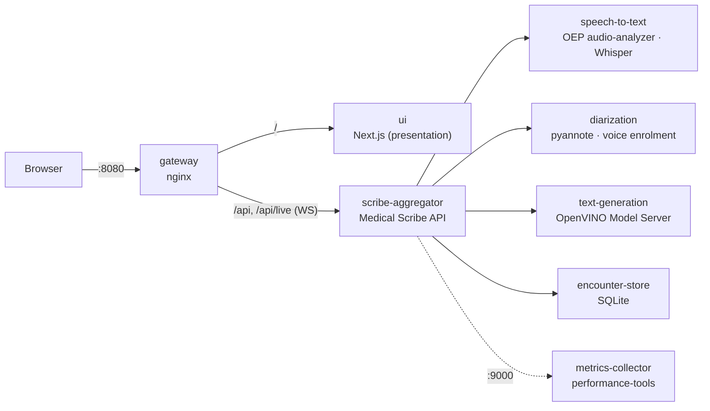

# Medical Scribe

Record or upload a doctor–patient consultation and get a speaker-labelled transcript and a draft
SOAP note (Subjective, Objective, Assessment, Plan). All AI runs on the device, on Intel® Core™
Ultra CPU, GPU and NPU: no audio or text leaves the machine.

Part of the Health and Life Sciences AI Suite. It started as an Edge AI Demo Studio sample
(`../medical-scribe`) and is now a standalone suite app built from independent services.

## Architecture


Source: [architecture.svg](docs/user-guide/_assets/architecture.svg) (edit it, then re-render the PNG). The same as text:



| Service | Image | What it does |
|---|---|---|
| gateway | `intel/hl-ai-medical-scribe-gateway` | The only published port. UI at `/`, API at `/api` |
| ui | `intel/hl-ai-medical-scribe-ui` | Today, Consultations and System pages. Calls only `/api` |
| scribe-aggregator | `intel/hl-ai-medical-scribe-aggregator` | Encounters, doctors, the transcription pipeline, speaker alignment, live sessions, SOAP note streaming, metrics |
| encounter-store | `intel/hl-ai-medical-scribe-encounter-store` | Encounters (transcript, note, timings) and doctor profiles (voice embedding) |
| speech-to-text | `intel/audio-analyzer` (published OEP image, not built) | Whisper on OpenVINO, batch and live (`/v1/realtime`) |
| diarization | `intel/hl-ai-medical-scribe-diarization` | pyannote `speaker-diarization-community-1`, doctor voice embeddings |
| text-generation | `intel/hl-ai-medical-scribe-text-generation` | OpenVINO Model Server writing the SOAP note; the model is set in `configs/model-config.yaml` and loaded at start |
| metrics-collector | `intel/retail-benchmark` | performance-tools: CPU, GPU, NPU, memory and power on `:9000` |

How it works in detail: [docs/user-guide/how-it-works.md](docs/user-guide/how-it-works.md).

## Requirements

- Ubuntu 24.04 on Intel® Core™ Ultra (validated on Arrow Lake, Core Ultra 7 265K), with the Intel GPU kernel driver; the NPU driver if you use the NPU.
- Docker with Compose v2.
- A Hugging Face token that has accepted the terms of
  [pyannote/speaker-diarization-community-1](https://huggingface.co/pyannote/speaker-diarization-community-1).
- About 25 GB of disk for images and 6 GB for models.

## Quick start

```bash
make setup                 # creates .env and the host folders
# edit .env: HF_TOKEN=hf_...
make build                 # base image + 7 service images
make up                    # starts everything and waits until healthy
```

Open <http://127.0.0.1:8080>.

The first start downloads and converts the models (Whisper, pyannote, Qwen3.5-4B), which takes
several minutes. If the Demo Studio version already downloaded them, reuse them:

```bash
make import-models FROM=../medical-scribe/models
```

| Command | |
|---|---|
| `make status` | Container state and health |
| `make logs SERVICE=scribe-aggregator` | Follow one service's log |
| `make down` | Stop (models and data stay) |
| `make help` | All targets |

## Using it

1. **Doctors** (Consultations page): add a doctor and enrol their voice (10 s). Their speech is then labelled *Doctor*, the other voice *Patient*.
2. **New encounter**: name, doctor, language (or auto-detect).
3. **Record** (live transcript while you speak) or **Upload** a recording. The transcript is labelled by speaker when processing ends.
4. **Generate note**: the SOAP note streams in. Edit it, copy it, mark it reviewed.
5. **System performance** (right-hand panel on every page, as in the patient-monitoring app):
   platform configuration, AI pipeline status, live CPU / GPU / NPU / memory / power charts, and the
   last encounter's AI timings. Collapse it with the arrow; **Details** opens the per-encounter timings table.

## Configuration

### Models and devices (`configs/model-config.yaml`)

Edit [configs/model-config.yaml](configs/model-config.yaml), then `make restart`. A new model is
downloaded (and converted where needed) on first start.

| Section | Keys (default) | |
|---|---|---|
| `speech-to-text` | `model` (`openai/whisper-large-v3-turbo`), `device` (`GPU`), `precision` (`int8`) | Device: `CPU`, `GPU`, `NPU` |
| `diarization` | `model` (`pyannote/speaker-diarization-community-1`, fixed), `device` (`cpu`), `speaker_match_threshold` (`0.5`) | Device: `cpu` or `xpu:0` |
| `text-generation` | `model` (`OpenVINO/Qwen3.5-4B-int4-ov`), `device` (`GPU`), `cache_size` (`0`) | Any Hugging Face OpenVINO LLM repository. Device: `CPU`, `GPU`, `NPU`, `AUTO` |
| `text-generation.generation` | `temperature` (`0.7`), `top_p` (`0.9`), `repetition_penalty` (`1.1`), `max_tokens` (`2048`) | Note generation |

The SOAP prompt is `prompts.soap` in the same file. It is read for every note, so prompt edits apply without a restart.

### Deployment (`.env`)

| Variable | Default | |
|---|---|---|
| `HF_TOKEN` | — | Required (diarization) |
| `BIND_ADDRESS` / `UI_PORT` | `127.0.0.1` / `8080` | Where the UI is published |
| `TAG`, `REGISTRY` | `latest`, `intel/` | Image names |
| `AUDIO_ANALYZER_TAG` | `2026.3.0-rc2` | `intel/audio-analyzer` tag (speech to text) |

## API

The UI is a client of the same API that other systems (an EHR integration, batch jobs) can use.
Interactive docs: <http://127.0.0.1:8080/api/docs>. Details in
[docs/user-guide/how-it-works.md](docs/user-guide/how-it-works.md#api).

```bash
curl -X POST localhost:8080/api/encounters -H 'Content-Type: application/json' -d '{"name":"Visit 1","language":"en"}'
curl -X POST localhost:8080/api/encounters/<id>/audio -F file=@visit.wav     # starts the pipeline
curl localhost:8080/api/encounters/<id>                                       # poll: status, transcript
curl -N -X POST localhost:8080/api/encounters/<id>/note                       # SOAP note (server-sent events)
```

## Security

- The app has **no login**. It is published on `127.0.0.1` only. Before exposing it on a network,
  put a TLS reverse proxy with authentication in front of the gateway.
- Only the gateway publishes a port; every other service is on the internal `medical-scribe-ms` network.
- Services run as non-root users. `metrics-collector` runs privileged with the host PID namespace
  because it reads hardware counters (as in the other suite apps).
- Encounters, transcripts, notes and voice embeddings are clinical data. They are stored in
  `data/encounter-store/encounters.db`; protect and back up that folder accordingly.

## Known limitations

- Diarization runs on the CPU by default and is the slowest stage (about 1.6× the audio length on a Core Ultra 7 265K). `device: xpu:0` (diarization section of `configs/model-config.yaml`) is not yet validated in the container.
- The live view shows the transcript only. Speaker labels appear when the recording has been processed.
- The GPU user-space driver in the images is pinned to 26.05.37020.3, the version validated on the host. 26.18 (used by `openvino/model_server:2026.4.1-gpu`) makes Qwen3.5-4B int4 produce garbage text on Arrow Lake.
