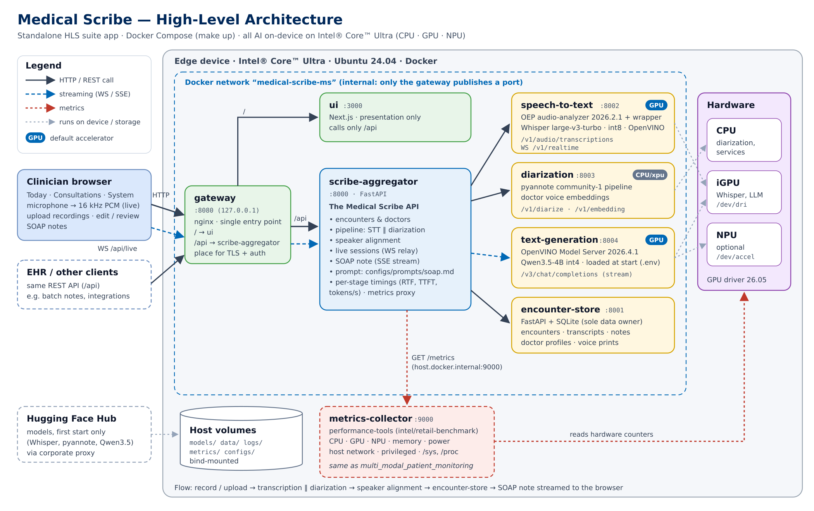
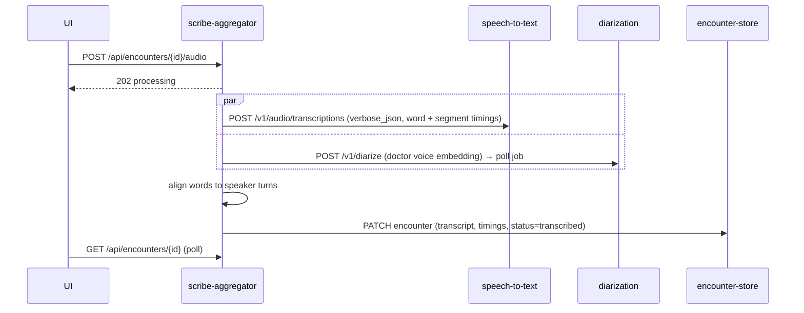

# How it works

## Services and responsibilities

| Service | Owns | Talks to |
|---|---|---|
| **gateway** (nginx) | The single entry point: `/` → ui, `/api` → scribe-aggregator (HTTP, server-sent events, WebSocket) | ui, scribe-aggregator |
| **ui** (Next.js) | Screens only: Today, Consultations, System | `/api` only |
| **scribe-aggregator** (FastAPI) | The Medical Scribe workflow: encounters API, transcription pipeline, speaker alignment, live sessions, SOAP note generation, per-stage timings, metrics proxy | all services below |
| **encounter-store** (FastAPI + SQLite) | Encounters and doctor profiles. No other service reads its database | — |
| **speech-to-text** | Transcription: OEP audio-analyzer (`edge-ai-libraries` 2026.2.1) with Whisper on OpenVINO GenAI, wrapped by the `oep` worker (health check, browser formats, model flags) | — |
| **diarization** | Who spoke when, pyannote `speaker-diarization-community-1`; speaker embeddings for doctor enrolment | — |
| **text-generation** | OpenVINO Model Server 2026.4.1 serving `LLM_MODEL` with the OpenAI chat API; model pulled and loaded at start | — |
| **metrics-collector** | performance-tools (`intel/retail-benchmark`): CPU, GPU, NPU, memory, power | host `/sys`, `/proc` |

Compared with the Demo Studio sample, the workflow logic (pipeline, alignment, prompt) moved from
the browser to `scribe-aggregator`. The UI no longer starts, stops or configures services, and each
service is configured from the environment and ready on its own.

## Upload flow

- Speaker alignment (`services/scribe-aggregator/app/align.py`):
  1. Each timed word goes to the speaker turn it overlaps most.
  2. Words are grouped into sentences.
  3. Each sentence takes the speaker with the most word time.
  - Falls back to segment timings, then to splitting by duration.
- With an enrolled doctor, the voice that matches the doctor's embedding is **Doctor** and the other **Patient**. Without one, two speakers are labelled *Speaker 1* and *Speaker 2*.
- If one of the two calls fails, the other is cancelled and the encounter shows the error.

## Live flow

- The browser captures the microphone, downsamples it to 16 kHz 16-bit mono, and streams it to `WS /api/live/{id}`.
- The aggregator:
  - relays the audio to audio-analyzer's OpenAI Realtime-style `/v1/realtime`;
  - sends each transcribed utterance back as `{"type": "utterance", "text"}`;
  - keeps the audio.
- On **Stop** (or if the browser disconnects), the recording goes through the upload flow, which adds word timings and speaker labels.

## SOAP note

- `POST /api/encounters/{id}/note` sends the labelled transcript (`Speaker: text` lines) and the prompt in `configs/prompts/soap.md` to the LLM.
- Request settings: thinking disabled, `</think>` as a stop word.
- The note streams back as server-sent events (`delta`, then `done` or `error`), and is saved with its timings once complete.

## Performance metrics

| Source | Metrics |
|---|---|
| metrics-collector (performance-tools) | CPU %, GPU %, NPU %, memory, package power, platform info; shown live on the System page |
| scribe-aggregator, per encounter | audio length; speech-to-text time and real-time factor (RTF); diarization time and RTF; note time to first words, tokens/s, total time |

Measured on Core Ultra 7 265K (Whisper large-v3-turbo int8 on GPU, pyannote on CPU, Qwen3.5-4B int4
on GPU), 133 s consultation:

| Stage | Time |
|---|---|
| Speech to text | 15.6 s (RTF 0.12) |
| Diarization | 221 s (RTF 1.66) |
| SOAP note | first words 3.0 s, 14.8 tokens/s, 22.8 s total |

## API

All under `/api` on the gateway; interactive docs at `/api/docs`.

| Method | Path | |
|---|---|---|
| GET | `/api/status` | Readiness of each AI service |
| GET | `/api/config` | Models and devices in use |
| GET / POST | `/api/doctors` | List / add doctors |
| DELETE | `/api/doctors/{id}` | Remove a doctor |
| POST | `/api/doctors/{id}/voice` | Enrol the voice (multipart `file`, ≥ 3 s of speech) |
| GET / POST | `/api/encounters` | List / create (`name`, `doctor_id`, `language`) |
| GET / PATCH / DELETE | `/api/encounters/{id}` | Read; edit `name`, `note`, `reviewed`; delete |
| POST | `/api/encounters/{id}/audio` | Upload a recording (multipart `file`); starts the pipeline |
| POST | `/api/encounters/{id}/note` | Generate the SOAP note (server-sent events) |
| WS | `/api/live/{id}` | Live consultation (binary PCM frames, then `{"type":"stop"}`) |
| GET | `/api/metrics` | Hardware metrics from metrics-collector |

Encounter `status`: `new` → `recording` → `processing` → `transcribed` (or `error`).

## Data and models

| Host folder | Contents |
|---|---|
| `data/encounter-store/` | `encounters.db`: encounters, transcripts, notes, doctor voice embeddings (clinical data) |
| `models/stt`, `models/huggingface` | Whisper OpenVINO export and its source |
| `models/diarization` | pyannote pipeline |
| `models/text-generation` | The LLM (OpenVINO IR) |
| `logs/`, `metrics/` | Service logs, raw metrics-collector output |

## Design decisions

| Decision | Why |
|---|---|
| Workflow in a backend service (`scribe-aggregator`) | Any client can get a note; processing survives a closed browser; prompt and logic change without a UI rebuild |
| One gateway, internal bridge network | One place for TLS and authentication later; internal ports are not exposed |
| One image per service | Independent builds and upgrades; each pins its own dependencies |
| LLM model from `.env`, loaded at start | The service is ready on its own; no UI step loads the model |
| OVMS release archive on our base image instead of `openvino/model_server:2026.4.1-gpu` | That image's GPU driver (26.18) makes Qwen3.5-4B int4 produce garbage text on Arrow Lake; the base pins the validated 26.05 |
| audio-analyzer with the `oep` wrapper instead of the plain upstream image | The wrapper adds the health check, browser audio formats and model flags the pipeline needs |
| Shared Python workspace in `libs/workers` | speech-to-text and diarization reuse the pinned, locked Demo Studio worker code |
