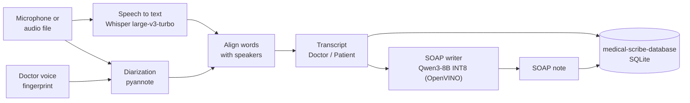
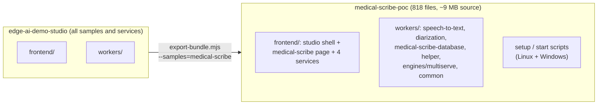

# Medical Scribe — Overview

## What it is

Medical Scribe is an AI assistant for doctors. It listens to a doctor-patient
consultation, writes down what was said, labels who said it (doctor or patient),
and drafts the clinical note in the standard **SOAP** format. Everything runs on
the local Intel PC; the conversation does not go to the cloud.

It is the first sample of the planned **Medical Terminals** category in HLS AI
Suite (Jira [ITEP-97800](https://jira.devtools.intel.com/browse/ITEP-97800)):
AI on the everyday PCs used next to the patient — carts, bedside terminals and
exam-room PCs.

## What it does (user view)

1. **Doctor profile (once):** the doctor records a short voice sample. The app
   stores a voice "fingerprint" (embedding) so it can tell the doctor apart from
   the patient later.
2. **New session:** pick the doctor and the language (English, Malay, Chinese, or
   a mix).
3. **Record** the consultation with live transcription, or **upload** an audio
   file.
4. **Process:** the app produces a transcript labelled by speaker, for example:
   - **Doctor:** "How long have you had the fever?"
   - **Patient:** "Three days, 38.5 at home."
5. **Generate SOAP note:** a language model writes the note and streams it to the
   screen.
6. **Sessions** are saved with their status (recording, processing, completed,
   error) and can be renamed, deleted or reprocessed. Interrupted sessions are
   recovered.

### SOAP note

| Section | Content |
|---|---|
| **S**ubjective | What the patient reports: symptoms, history, home readings |
| **O**bjective | What the clinician measured or examined during this visit |
| **A**ssessment | The doctor's stated impression or diagnosis |
| **P**lan | Tests, treatment, medicines, advice and follow-up the doctor gave |

The note-writing prompt (`frontend/src/samples/medical-scribe/lib/soap.ts`) sets
strict rules:
- use only what was said; anything not discussed is written as "Not discussed";
- home readings go in Subjective, never in Objective;
- numbers, units, drug names and doses are copied exactly; garbled values are
  listed under "Items to Verify";
- the transcript may be English, Malay, Chinese or mixed; the note is always in
  English.

## What is used

| Step | Service | Model (recommended) | Device |
|---|---|---|---|
| Speech to text | `speech-to-text` | `openai/whisper-large-v3-turbo` (Qwen3-ASR optional via OVMS) | GPU |
| Who said what | `diarization` | `pyannote/speaker-diarization-community-1` | Intel GPU (XPU) |
| Write the note | `text-generation` (multiserve engine) | `OpenVINO/Qwen3-8B-int8-ov` | GPU |
| Store sessions | `medical-scribe-database` | — (FastAPI + SQLite) | CPU |

Software stack:
- **Frontend:** Next.js / React (TypeScript), Payload CMS for users and settings.
- **Backend workers:** Python services managed by the frontend; OpenVINO,
  OpenVINO Model Server (OVMS) and llama.cpp (SYCL or Vulkan) for inference.
- **Tools downloaded by setup:** Node.js, FFmpeg, qmassa (GPU monitor).

Notes:
- The pyannote model is gated on Hugging Face: accept its terms and provide a
  Hugging Face token in the app.
- Models are downloaded when a service is started in the web UI; they are not
  part of this folder (see [How model download works](#how-model-download-works)).

## How it works



1. **Record:** the browser records audio. In live mode the speech-to-text
   service transcribes as the doctor speaks, and those live results are reused
   later instead of transcribing again.
2. **Transcribe and diarize in parallel:** the audio goes to speech-to-text
   (text with word timings) and to diarization (speaker time segments).
   - With a doctor profile, diarization compares voices with the doctor's
     fingerprint and labels segments "Doctor" or "Patient".
   - Without a profile, it assumes two speakers.
3. **Align:** frontend code (`lib/alignment/`) matches each word to the speaker
   talking at that time, producing the labelled transcript.
4. **Generate the note:** the transcript and the SOAP prompt go to the
   text-generation service; the note streams back to the page.
5. **Save:** sessions, transcripts, notes and doctor profiles are stored by the
   `medical-scribe-database` service in SQLite.

## Intel optimization and devices

Yes, the scribe is built on Intel-optimized software. Every AI step runs on an
Intel inference stack, and the device (CPU, GPU or NPU) is chosen per service in
the web UI. NPU support depends on the service. (Based on the code and
configuration; not yet benchmarked here.)

| Step | What runs it | Intel software | Devices | Recommended |
|---|---|---|---|---|
| **Speech to text** (Whisper) | Two backends: **OpenVINO GenAI · OEP** (default, the OEP audio service) or **OpenVINO Model Server** (also runs Qwen3-ASR) | OpenVINO 2026.2, OpenVINO GenAI, OVMS | AUTO, CPU, GPU, **NPU** | GPU |
| **Diarization** (pyannote) | PyTorch with Intel XPU builds (`download.pytorch.org/whl/xpu`) | PyTorch on Intel GPU (XPU); not OpenVINO | CPU, XPU (Intel GPU) | XPU |
| **SOAP note** (LLM) | `multiserve` engine: **OpenVINO Model Server** for OpenVINO models, or **llama.cpp** for GGUF models | OpenVINO GenAI / OVMS; llama.cpp with **SYCL** (Intel GPU runtime) or Vulkan | CPU, GPU, **NPU** (OVMS) | GPU, Qwen3-8B INT8 |
| Voice detection (live mode) | silero-vad | — | CPU | CPU |
| Session database | FastAPI + SQLite | — | CPU | — |
| Model conversion | `optimum-cli export openvino` (optimum-intel, NNCF) | Hugging Face → OpenVINO IR, INT8 / INT4 | — | — |
| GPU monitoring | qmassa | Intel GPU usage and power | — | — |

NPU limits found in the code:
- **Speech to text:** Whisper Large v3 and v3 Turbo are marked "no NPU": they
  compile for the NPU 3720 but fail at inference (driver limit). Smaller Whisper
  models (medium, small, tiny) can use the NPU.
- **LLM:** the OVMS NPU plugin limits some Qwen3 models to about 8k tokens of
  context; the engine applies this limit automatically.
- **Diarization:** CPU or Intel GPU only.

The recommended setup therefore runs everything on the **Intel GPU**, with the
NPU as an option for smaller models.

## How model download works

All workers fetch weights through one shared package,
`workers/common/downloader` (`model_downloader`), with four methods:

| Method | Used for | How |
|---|---|---|
| `oep` | Hugging Face (plus other upstream plugins) | Intel's **OEP model-download microservice** (`open-edge-platform/edge-ai-libraries`), used directly as a Python module — no separate container |
| `ovms --pull` | LLM and the OVMS speech-to-text backend | OpenVINO Model Server **downloads and converts** the model in one step |
| `modelscope` | Alternative source (for example in China) | ModelScope SDK |
| `http` | Single files, Open Model Zoo IR pairs | Plain HTTPS download, atomic write, optional sha256 |

1. **When:** downloads start when a service is **started in the web UI**, not
   during `setup.sh`; the UI shows the progress.
2. **Pre-converted models** (for example `OpenVINO/Qwen3-8B-int8-ov`) are
   downloaded ready to run.
3. **Other Hugging Face models** are converted to OpenVINO IR with the chosen
   weight format (INT4, INT8 or FP16) during `ovms --pull`.
4. **Gated models** such as pyannote need the terms accepted on Hugging Face and
   a **Hugging Face token** set in the app.
5. **Mirrors:** `HF_ENDPOINT` in `frontend/.env` can point downloads at a
   mirror, or ModelScope can be used as the source.
6. **Storage:** LLM files go under `workers/engines/multiserve/models/` (`OV/`
   for OpenVINO, `GGUF/` for llama.cpp); this folder is git-ignored.

## What we pulled from upstream

**Source:** `open-edge-platform/edge-developer-kit-reference-scripts`, branch
`main`, commit `7bdfd48`, folder `samples/ai/edge-ai-demo-studio`.

The sample page lives in
[`frontend/src/samples/medical-scribe`](https://github.com/open-edge-platform/edge-developer-kit-reference-scripts/tree/main/samples/ai/edge-ai-demo-studio/frontend/src/samples/medical-scribe),
but it cannot run alone: it is one sample inside **Edge AI Demo Studio** and
needs the studio shell and four backend services. We therefore used Demo
Studio's own export tool, which copies only what this sample needs:

```bash
cd samples/ai/edge-ai-demo-studio
thirdparty/node/bin/node scripts/export-bundle.mjs --samples=medical-scribe --out=<target>
```



| Folder | What it contains | Upstream location |
|---|---|---|
| `frontend/src/samples/medical-scribe/` | The Medical Scribe page: components, hooks, SOAP prompt, alignment | same path |
| `frontend/src/services/` | Client code for `speech-to-text`, `diarization`, `text-generation`, `medical-scribe-database` | same path (other services removed) |
| `frontend/` (rest) | Demo Studio shell: app, components, Payload CMS, settings | same path |
| `workers/services/speech-to-text/` | Speech-to-text service (Whisper; OEP and OVMS variants) | same path |
| `workers/services/diarization/` | Speaker diarization service (pyannote) | same path |
| `workers/services/medical-scribe-database/` | Session and doctor-profile store (FastAPI + SQLite) | same path |
| `workers/services/helper/` | Shared helper service used by the studio | same path |
| `workers/engines/multiserve/` | LLM serving engine for text generation (OpenVINO / llama.cpp) | same path |
| `workers/common/` | Shared worker code: audio input, model downloader, OVMS export | same path |
| `setup.sh`, `start.sh`, `setup_win.bat`, `start_win.bat`, `install_dependencies.sh` | Setup and start scripts | repo root |
| `EXPORT_MANIFEST.json` | Exported sample, services and workers | generated by the export |

Not included: the other Demo Studio samples and services, the Electron desktop
app, `docker/`, and tests.

Local additions after the export:
- `.gitignore` at the root (the export does not copy Demo Studio's root
  `.gitignore`); it excludes `logs/`, `thirdparty/`, virtual environments,
  `frontend/node_modules`, `frontend/.next`, `frontend/.env`,
  `frontend/db.sqlite` and models.
- `docs/` (this file).

## How to run

```bash
# optional system packages (needs sudo)
sudo apt install -y vulkan-tools libportaudio2

bash setup.sh --backend sycl   # Node, FFmpeg, Python envs, frontend build
bash start.sh                  # web UI
```

- The web UI port is set by `PORT` in `frontend/.env` (default 8080; copy
  `frontend/.env.example` to `frontend/.env` on a fresh clone). On our test
  machine 8080 is used by NICU Warmer, so we use `PORT=8090`.
- Backend services use ports from `INSTANCE_PORT_RANGE` (default 8100–8199).
- In the browser: create the admin user, start the four services with the
  recommended models, add the Hugging Face token for pyannote, then open
  **Samples → Medical Scribe**.

## Points to note

- **Patient data:** recordings, transcripts and notes are protected health
  information. The SQLite store has no encryption or retention settings in this
  sample; this must be defined before any real use.
- **Licenses:** confirm the licenses of all models (pyannote is gated on Hugging
  Face).
- **Not for clinical use:** reference implementation only.
- **Sync with upstream:** Demo Studio changes often; re-run the export and
  compare when updating.

## Open questions

For the app owner ([ITEP-97800](https://jira.devtools.intel.com/browse/ITEP-97800)).

**Deployment and use case**

1. Which device should it target: a medical cart, a bedside terminal, or an exam-room PC? What is the minimum hardware (Intel GPU / NPU, RAM)? Qwen3-8B INT8 alone needs about 9 GB.

2. One doctor per PC, or one shared server for several exam rooms (several sessions at the same time)?

3. Must it work fully **offline** (models pre-installed, no internet at runtime) on a hospital network?

4. Should it connect to other systems, for example send SOAP notes to an EMR (HL7 / FHIR), or link with other suite apps (Multi-Modal, PM Hub)?

**Setup and platforms**

5. Keep Demo Studio's native `setup.sh` / `start.sh`, or follow the suite's Docker + `make` pattern?

6. Is the desktop app (Electron) and native Windows support required, or is the web UI on Linux enough?

7. Which hardware and OS to validate (Core Ultra models; Ubuntu 24.04, Windows 11)?

**Models and devices**

8. Which models are official (Whisper large-v3-turbo, pyannote, Qwen3-8B INT8)?

9. Are these models licensed for commercial use, and is the gated pyannote model (Hugging Face token) acceptable for customers?

10. Which devices must be validated: GPU only, or must the **NPU** work too (large Whisper models fail on the NPU today)?

11. Which languages to validate: English, Malay, Chinese, mixed?

12. Is the China-specific speech recognition (2027.1 roadmap) in scope now?

13. Are there accuracy or speed targets for transcription, speaker labels or note quality? Is there a test set?

**Data and security**

14. What is required for storing, encrypting and deleting recordings, transcripts and notes (the local SQLite store has no encryption today)?

15. Are there security, license or scan requirements before release?
