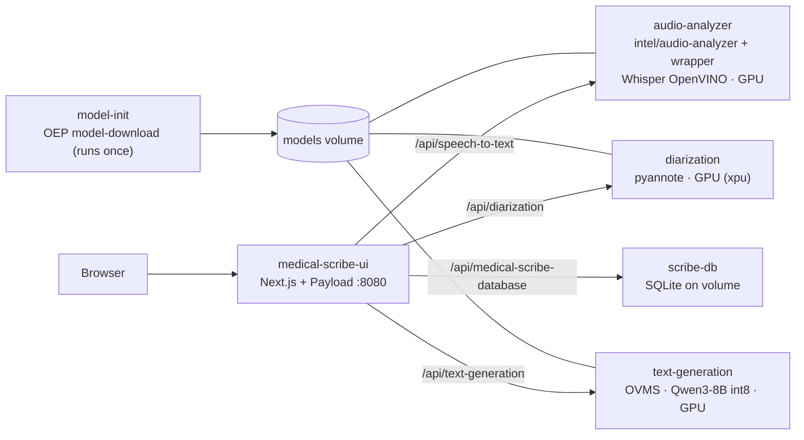
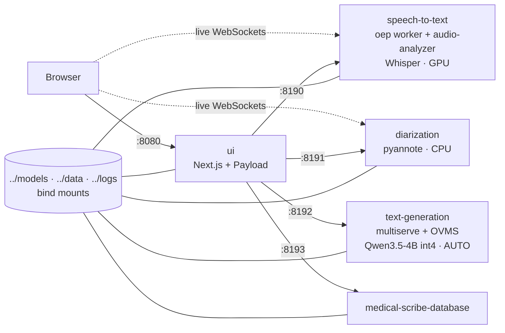

# Medical Scribe: containerization plan (`make up`)

Today the Next.js frontend starts every service itself as a native process (Demo Studio "worker" mode), and the user starts each one from the UI. The goal is to run the whole Medical Scribe in containers with one command, `make up`, the same way as the other HLS suite apps.

Related: [OEP audio-analyzer and DL Streamer plan](oep-audio-analyzer-and-dlstreamer-plan.md).

> **Status:** phases 1–3 are implemented with a simpler design than planned below. See [5. As built](#5-as-built) for what exists, how to run it, and what is still open.

## 1. Why the frontend has to change

The frontend can only talk to services it started itself. The service execution types are `'worker' | 'none' | 'multiserve'` (`frontend/src/types/service.ts`), and there is no setting for the URL of an already running service. The frontend forwards its calls through `/api/<service-type>/*` (`frontend/src/services/_generated/proxied-services.ts`):

- `speech-to-text`
- `diarization`
- `text-generation`
- `medical-scribe-database`

Containers alone are not enough: the frontend needs a mode in which it uses those services at configured URLs instead of starting them.

## 2. Target architecture



| Container | Image source | Notes |
|---|---|---|
| `medical-scribe-ui` | New Dockerfile for `frontend/` | Payload CMS SQLite on a volume. `PAYLOAD_SECRET` comes from `.env` and must stay the same across restarts. |
| `audio-analyzer` | Upstream `intel/audio-analyzer:<tag>` (its compose file uses `2026.3.0-rc1`, port 8010) plus a thin wrapper layer | The wrapper adds what `workers/services/speech-to-text/oep/main.py` adds today:<br>• `/healthcheck`<br>• browser audio formats (WebM/Opus/FLAC)<br>• reporting the language detected with `language=auto`<br>• the `--model/--device/--precision` → `AUDIO_ANALYZER__MODELS__ASR__*` mapping |
| `diarization` | New Dockerfile from `workers/services/diarization` | pyannote `speaker-diarization-community-1` on Intel GPU (`xpu`). Hugging Face token passed in at runtime. Doctor voice enrolment (`/v1/embedding`) is kept. |
| `text-generation` | Official `openvino/model_server` GPU image | Serves `OpenVINO/Qwen3-8B-int8-ov` through an OpenAI-compatible chat API. In container mode it replaces the native "multiserve" engine. |
| `scribe-db` | New small Dockerfile from `workers/services/medical-scribe-database` | SQLite on a volume. |
| `model-init` | OEP `model-download` | Downloads and converts Whisper, pyannote and Qwen3-8B into a shared models volume once, so the services don't do it on first start. |

All service containers:

- get `/dev/dri` (GPU) and `/dev/accel` (NPU) where needed, plus the `video`/`render` groups;
- run as a non-root user;
- read the proxy settings and define a healthcheck;
- mount the shared models volume.

## 3. Roadmap

### Phase 0: check feasibility

- Run the upstream `intel/audio-analyzer` image and compare it with today's native `oep` worker:
  - browser audio formats;
  - `language=auto` and reporting the detected language;
  - word timestamps (`timestamp_granularities[]=word`);
  - NDJSON/SSE streaming and the `/v1/realtime` WebSocket;
  - CPU, GPU and NPU.
- Check pyannote on an Intel GPU inside a container (`/dev/dri`, Intel GPU runtime).
- Check OVMS on GPU serving Qwen3-8B int8.
- **Output:** a gap list, deciding what goes in the wrapper layer and what gets contributed upstream.

### Phase 1: frontend can use services it doesn't start

- Add an `external` execution mode next to `worker`. Each service's URL comes from an environment variable:

  | Variable | Service |
  |---|---|
  | `STT_URL` | speech-to-text (audio-analyzer) |
  | `DIARIZATION_URL` | diarization |
  | `LLM_URL` | text-generation |
  | `SCRIBE_DB_URL` | medical-scribe-database |

- In `external` mode the UI shows health and the active model and device, and hides Start/Stop. The `/api/<service-type>/*` proxy routes to the configured URL.
- Keep `worker` mode as is for the native Demo Studio flow.
- Propose the change to the Demo Studio owner so future re-exports don't conflict.

### Phase 2: container images and compose for the services

- Dockerfiles for the audio-analyzer wrapper, diarization and scribe-db.
- `docker-compose.yaml` using the upstream audio-analyzer and OVMS images, with device access, proxy settings, healthchecks, non-root users and the models volume.
- The frontend can still run natively (`./start.sh`) in `external` mode against the containers.

### Phase 3: one command

Containerize the frontend and add a `Makefile`, following the multi-modal app's pattern:

```bash
make setup            # create .env, generate PAYLOAD_SECRET, ask for the HF token, proxy settings
make download-models  # model-init: Whisper, pyannote, Qwen3-8B into the models volume
make up DEVICE=GPU    # docker compose up -d --wait
make status           # container health and active models
make logs             # follow logs
make down             # stop
make build REGISTRY=<registry>/ TAG=<tag>   # build images locally
```

Sample defaults, all overridable in `.env`:

| Service | Model | Device |
|---|---|---|
| Speech to text | `openai/whisper-large-v3-turbo`, int8 | GPU |
| Diarization | `pyannote/speaker-diarization-community-1` | xpu |
| Text generation | `OpenVINO/Qwen3-8B-int8-ov` | GPU |

### Phase 4: release readiness

- Publish images to the `intel/` registry under the release tag.
- Third-party programs file (like `third_party_programs_nicu-warmer.txt`), SBOM and security scan for every image.
- Docs: get-started, configuration, troubleshooting.
- CI smoke test: upload sample audio and check that a transcript with speakers and a SOAP note come back.
- Optional Helm chart.

### Phase 5: Windows

- Keep the native `setup_win.bat` / `start_win.bat` path on Windows.
- Docker on Windows has limited Intel GPU access and no NPU, which matters for the native Windows requirement (ITEP-97825).

## 4. Risks

| Risk | Mitigation |
|---|---|
| Drift from Demo Studio: the `external` mode changes the frontend, so re-exports conflict | Propose it upstream; keep the change small and behind the execution mode |
| Image size: torch + OpenVINO in the audio-analyzer and diarization images is several GB | Separate CPU and GPU variants; share base layers |
| Live mode: `/v1/realtime` and the diarization WebSocket must pass through the Next.js proxy between containers | Test live mode in Phase 2 |
| Gated pyannote model needs a Hugging Face token with the model terms accepted | `make setup` checks access before `make up` |
| Whisper, pyannote and Qwen3-8B on one GPU | Measure memory on Arrow Lake; allow a different device per service in `.env` |
| First-start model downloads and conversion behind the proxy | `make download-models` with retries; models volume reused across restarts |

## 5. As built

### Design, and how it differs from the plan

| Plan | As built | Why |
|---|---|---|
| Bridge network, frontend proxies everything | **Host networking**, every service binds `127.0.0.1` | Live mode: the browser opens the STT `/v1/realtime` and diarization WebSockets **directly** to the service ports, not through the Next.js proxy. Host ports must therefore be fixed and reachable on loopback. |
| New `external` execution mode + `STT_URL`, `LLM_URL`, … | Env var `EXTERNAL_SERVICES="<type>=<port>,…"` on top of the existing modes | No Payload schema change, no migration, small diff against the Demo Studio export. The rows keep their `worker` / `multiserve` engine; the app just doesn't spawn or stop them. |
| Upstream `intel/audio-analyzer` image + wrapper | Our `oep` worker in its own image (`stt` target), audio-analyzer fetched at the tag `workers/upstream.json` pins | The `oep` worker already *is* the wrapper (browser formats, `/healthcheck`, detected language, flag mapping). |
| Official OVMS image, replaces multiserve | **multiserve** in the `workers` image, OVMS binary inside | The UI drives model loading over HTTP (`/v1/model/download/unverified`, `/v1/start`), so model selection in the UI keeps working. |
| `model-init` container | Not built; models download on first start into the bind-mounted `models/` | `models/` is shared with the native run, so already downloaded models are reused. |
| Diarization on `xpu` | `DIARIZATION_DEVICE=cpu` by default | The image installs the CPU torch wheel set from the lock file; `xpu` in a container is not validated yet. |



### Files

| File | Purpose |
|---|---|
| `docker/Dockerfile` | Multi-stage: `runtime` (Ubuntu 24.04, Intel GPU/NPU user-space drivers pinned like upstream audio-analyzer, FFmpeg, non-root `appuser` uid 1000) → `workers` (uv, OVMS, shared `workers/.venv` with diarization, database, multiserve) → `stt` (audio-analyzer `.venv`) and `ui` (Node, `npm ci`, `next build`). |
| `docker/docker-compose.yaml` | Five services, host network, `/dev/dri` + NPU, `render`/`video` groups, proxy env, healthchecks, `models`/`data`/`logs` bind mounts. |
| `docker/.env.example` → `docker/.env` | Ports, devices, models, `PAYLOAD_SECRET`, `HF_TOKEN`, gids. `docker/.env` is git-ignored. |
| `Makefile` | `setup`, `build`, `up`, `down`, `restart`, `logs [SERVICE=…]`, `status`, `ps`. |
| `.dockerignore` | Keeps models, data, venvs, `node_modules`, `.next` and secrets out of the build context. |
| `deployment.json` | Creates and starts the four service rows on first boot (native `./start.sh` and container alike). |
| `frontend/src/lib/workers/external-services.ts` + hooks in `instance-ports.ts`, `worker-lifecycle.ts`, `health/status.ts`, `health/poller.ts`, `app-boot.ts`, `engines/multiserve/process-handler.ts` | The external mode: fixed port per type, no spawn/stop, health-only status, multiserve "already running", ports excluded from boot cleanup. |

### Ports

The app only probes and proxies to ports in its **instance port range, 8100–8199** (`INSTANCE_PORT_RANGE`); `EXTERNAL_SERVICES` entries outside it are ignored with a warning. The containers use the top of the range so they don't collide with ports the app hands out to instances it starts itself:

| Service | Port |
|---|---|
| ui | 8080 |
| speech-to-text | 8190 |
| diarization | 8191 |
| text-generation | 8192 |
| medical-scribe-database | 8193 |

### Run

Stop the native app first (`./start.sh` and its workers use 8080 and the GPU).

```bash
make setup     # docker/.env: PAYLOAD_SECRET, render/video gids, NPU device; creates models/ data/ logs/
# edit docker/.env: HF_TOKEN=hf_...   (pyannote is gated; accept its terms on Hugging Face)
make build     # three images: medical-scribe-workers, -stt, -ui
make up        # docker compose up -d --wait
make status
make logs SERVICE=speech-to-text
make down
```

Open <http://127.0.0.1:8080> and create the admin user (the container UI has its own database, `data/ui/db.sqlite`). `deployment.json` creates the four services and the UI shows them `active` once their health checks pass; text-generation loads its model through multiserve on first boot.

### Behind the Intel proxy

`release-assets.githubusercontent.com` is sometimes TLS-intercepted by the proxy (certificate issued by *Intel Proxy Root CA*), so GitHub release downloads in the build fail with `curl: (60)` until a non-intercepting proxy node answers. The downloads retry 5 times and the build fails on the first download that still fails. If it keeps failing, rebuild. Do not disable TLS verification.

### Verified (Arrow Lake, 2026-11-25)

- All three images build; containers run as uid 1000 and see `/dev/dri` and `/dev/accel/accel0`.
- speech-to-text: `oep` backend, `whisper-large-v3-turbo` int8 on GPU, healthy.
- text-generation: multiserve + OVMS, `OpenVINO/Qwen3.5-4B-int4-ov` on AUTO, `AVAILABLE`.
- medical-scribe-database: healthy.
- UI: `deployment.json` rows created with the external ports; database, STT and text generation go `active`.

### Open

- [ ] Diarization: set `HF_TOKEN` in `docker/.env`, then verify healthy and `active`.
- [ ] End-to-end: gastritis sample upload → transcript with speakers → SOAP note.
- [ ] Live mode in the browser against 8190/8191.
- [ ] Diarization on `xpu` in the container.
- [ ] Native `./start.sh` with `deployment.json` (auto-start of the four services).
- [ ] Optional corporate CA as a BuildKit secret, if proxy interception becomes persistent.
- [ ] Phase 4 (registry, SBOM, third-party programs, CI smoke test) and README section.
