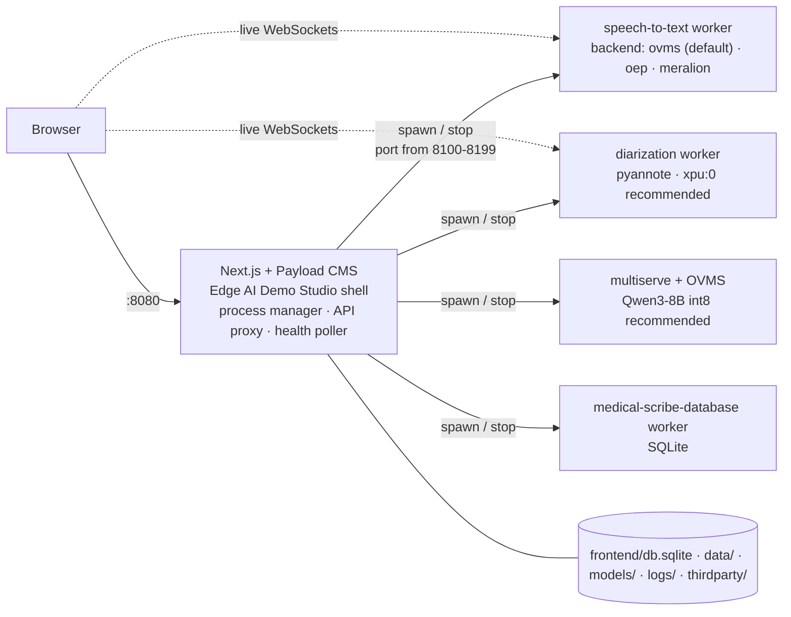
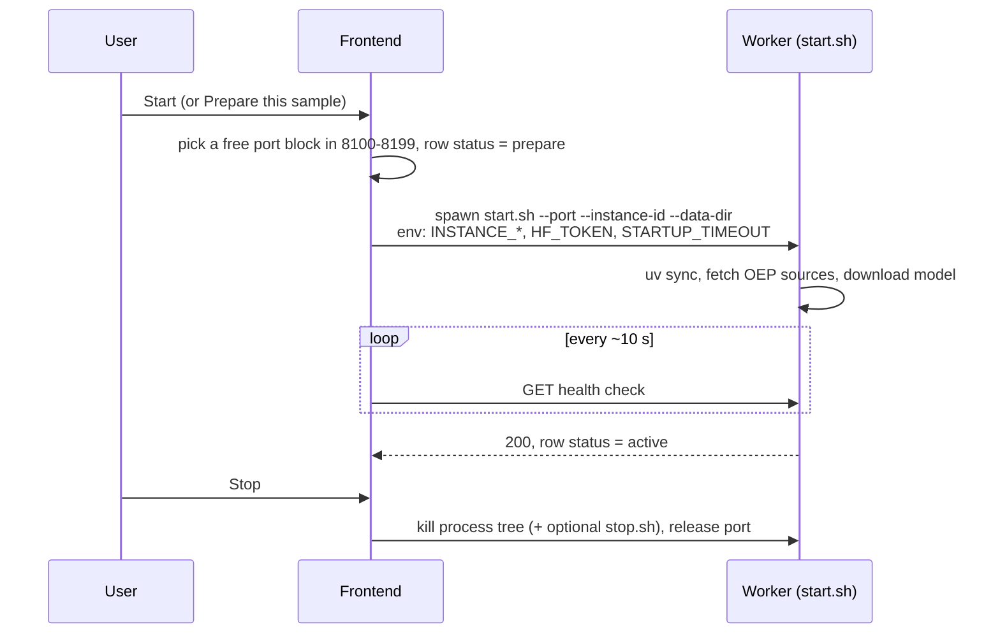

# Medical Scribe: High-Level Design, original app (as exported)

| | |
|---|---|
| Source | Edge AI Demo Studio export: `edge-developer-kit-reference-scripts/samples/ai/edge-ai-demo-studio`, `./export.sh --samples=medical-scribe` |
| Location | `/home/intel/sachin/health/medical-scribe` (exported 2026-11-25) |
| Platform | Ubuntu 24.04 or Windows 11, Intel CPU / GPU / NPU |
| Deployment | Native processes, no containers |

Related: [HLD of the containerized app](high-level-design.md), [architecture proposal](architecture-proposal.md). Diagram: page "Original app" in [_assets/medical-scribe-hld.drawio](_assets/medical-scribe-hld.drawio).

## 1. What it is

- A subset of **Edge AI Demo Studio**: the studio shell, the Medical Scribe sample, and the four services it needs. The export manifest lists them:
  - medical-scribe-database;
  - speech-to-text;
  - diarization;
  - text-generation.
- The **frontend starts and stops every service itself**, as a native process, when the user clicks Start in the UI.

## 2. Architecture

## 3. Components

| Component | Technology | Notes |
|---|---|---|
| Frontend / studio shell | Next.js 16, Payload CMS (SQLite `frontend/db.sqlite`), Node 24 | Dashboard, Services, Samples, System, Settings. Medical Scribe runs at `/samples/medical-scribe/demo`. |
| Process manager | Inside the frontend (`lib/workers/*`) | Starts each worker with `start.sh`, gives it a port from **8100–8199**, polls its health check, stops it |
| speech-to-text | `workers/services/speech-to-text/{ovms,oep,meralion}` | **Default backend `ovms`** (OpenVINO Model Server worker: Whisper or Qwen3-ASR). `oep` (audio-analyzer) and `meralion` are options. |
| diarization | `workers/services/diarization` | pyannote `speaker-diarization-community-1`; doctor voice embeddings |
| text-generation | `workers/engines/multiserve` | multiserve in front of OVMS or llama.cpp; OpenAI-compatible chat |
| medical-scribe-database | `workers/services/medical-scribe-database` | FastAPI + SQLite: sessions and doctor profiles |
| helper | `workers/services/helper` | Command-line scripts that list OpenVINO and PyTorch devices for the UI's device pickers; not an HTTP service, and Medical Scribe does not start it |

Sample defaults (`frontend/src/samples/medical-scribe/data.ts`):

| Service | Recommended model | Device |
|---|---|---|
| Speech to Text | `openai/whisper-large-v3-turbo` | GPU.0 |
| Diarization | `pyannote/speaker-diarization-community-1` | xpu:0 |
| Text Generation | `OpenVINO/Qwen3-8B-int8-ov` | GPU.0 |

### 3.1 How it works

#### Process manager (frontend, `frontend/src/lib/workers/`)

- **Start** (`worker-lifecycle.ts`, `process-handler.ts`): runs the worker's `start.sh` as a child process. It passes:
  - flags `--port`, `--instance-id`, `--data-dir`;
  - environment `INSTANCE_ID`, `INSTANCE_KEY`, `INSTANCE_DATA_DIR`;
  - `HF_TOKEN` and the startup timeout from Settings.
- **Ports** (`instance-ports.ts`): the first free block in **8100–8199** (override with `INSTANCE_PORT_RANGE`). The block is stored on the service row until the instance stops. A worker that needs more than one port (e.g. OVMS behind a worker) gets a block.
- **Health** (`health/poller.ts`, `health/status.ts`):
  - Every ~10 s the poller checks that the process is alive and calls its health check.
  - The row goes `prepare` → `active` on the first healthy answer.
  - It goes to `error` when the process exits, the startup timeout passes (default 600 s), or an active engine misses 3 checks in a row.
- **Stop / crash:** kills the process tree (SIGTERM on Linux, tree-kill on Windows), runs `stop.sh` if the worker has one, releases the port and archives the log.
- **Boot clean-up** (`app-boot.ts`): on every app start, rows are reset to inactive, ports are released, orphaned OVMS processes are killed, and port conflicts are cleaned up.
- **Logs:** `logs/<type>@<instanceId>.log`, rotated; older runs go to `logs/old/`.

#### Worker set-up (first start of each service)

- `workers/setup.sh` downloads **uv** (0.13.7) and **OVMS** (2026.4.1) with SHA-256 checks, and adds Jinja2 to OVMS for chat templates.
- All workers share one uv workspace environment, `workers/.venv`. Model converters (e.g. the Qwen3-ASR exporter) and the OEP audio-analyzer get their own `.venv`.
- `workers/upstream-setup.sh fetch` copies OEP sources (e.g. audio-analyzer, model-download) at the tag pinned in `workers/upstream.json`, only when that service or model is first used.
- Models are downloaded on first start into `models/<service>/…` (Hugging Face cache in `models/huggingface/`), using `HF_TOKEN` from Settings.
- The first start therefore takes minutes; later starts reuse everything.

#### speech-to-text

- **`ovms` backend (default)**, `workers/services/speech-to-text/ovms`:
  - The worker starts its own **OVMS** process (`ovms --pull --task speech2text`) on its port + 1 and serves the OpenAI-style API in front of it.
  - Models:
    - `openai/whisper-*` is exported to OpenVINO (int8 / fp16 / fp32 / int4) by the shared exporter;
    - Qwen3-ASR has its own converter;
    - `OpenVINO/*` repositories are downloaded as they are.
  - Endpoints: `POST /v1/audio/transcriptions`, `POST /v1/audio/translations`, `WS /v1/audio/stream`, `GET /healthcheck`.
  - **Live:** 16 kHz PCM frames over WebSocket. Silero VAD cuts utterances, and each utterance is transcribed and sent back with start/end times.
  - **Word timestamps** for Qwen3-ASR come from `Qwen/Qwen3-ForcedAligner-0.6B-hf`.
  - **Noise suppression** (optional, `use_denoise=true`): Open Model Zoo `noise-suppression-poconetlike-0001`.
- **`oep` backend:** the OEP audio-analyzer, unchanged, with a thin wrapper. Whisper on OpenVINO GenAI; live mode over `WS /v1/realtime`.
- **`meralion` backend:** `MERaLiON/MERaLiON-3-3B-ASR` only (Singapore / Southeast Asian speech); the language is always detected; transcription only.

#### diarization

- Loads the gated `pyannote/speaker-diarization-community-1` from Hugging Face into `models/diarization/`. It needs `HF_TOKEN` with the model's terms accepted.
- **Batch:** `POST /v1/diarize` queues a job and returns `job_id`; the client polls `GET /v1/diarize/{id}` (or SSE `/events`); `DELETE` cancels. An optional reference embedding labels the matching speaker (Doctor) and the others (Patient).
- **Enrolment:** `POST /v1/embedding` returns a speaker embedding from a short voice sample.
- **Live:** `WS /v1/audio/stream`, with the same Silero VAD protocol as STT. pyannote re-runs on a rolling window at utterance boundaries, and speaker names are kept across utterances.
- **Device:** `cpu` or Intel GPU `xpu:N` (PyTorch XPU).
- In Medical Scribe the browser sends one microphone stream to both STT and diarization, and waits until both WebSockets are open so the timelines line up.

#### text-generation (multiserve)

- `workers/engines/multiserve/start.sh` prepares the worker and OVMS, picks the llama.cpp backend (SYCL / Vulkan / CPU), then runs `app-hybrid.py`.
- multiserve is a FastAPI front end that **manages model servers**: it starts OVMS (OpenVINO models) or llama.cpp (GGUF models) as child processes.
- The UI drives it over HTTP:
  - `POST /v1/model/download/unverified` downloads a Hugging Face model into `models/multiserve/…`; OVMS models get a `graph.pbtxt`.
  - `/v1/start` loads the model.
  - `GET /v1/status` and `GET /v1/health` report state.
- It proxies OpenAI-compatible routes (`/v1/chat/completions`, embeddings, rerank) to the running backend. The SOAP note is a streamed chat completion.

#### medical-scribe-database

- FastAPI + SQLAlchemy on SQLite in the instance data directory: `data/medical-scribe-database/<instance>/medical_scribe.db`.
- Tables:
  - `sessions`;
  - `doctor_profiles`, which holds the voice embedding;
  - `transcripts`, `diarization_segments`, `session_dialogues`, `reports`, `audio_buffers`.
- Routes: `GET/POST /v1/sessions`, `PATCH/DELETE /v1/sessions/{id}`; `GET/POST /v1/doctor-profiles`, `PATCH/DELETE /v1/doctor-profiles/{id}`.

#### System monitoring (frontend, `frontend/src/lib/system/system-monitoring.ts`)

- CPU and memory come from Node.js (`os`).
- **GPU (Linux):** `qmassa` (built by `setup.sh`) samples engine busy time over 1 s. On Windows: GPU performance counters.
- **NPU (Linux):** `intel_vpu` sysfs (`/sys/class/accel`): busy time on newer kernels, otherwise active time. On Windows: performance counters.
- Polled every ~5 s, with a few minutes of history for the charts.

#### Settings (frontend, Payload global `app-settings`)

- **Hugging Face token:** encrypted at rest and never returned by the API. Passed to workers as `HF_TOKEN` when they start, and masked (`hf_***`) in logs.
- **Startup timeout:** default 600 s; how long a worker may take to become healthy.
- **Proxy timeout:** default 300 s; how long the `/api/<type>@<id>/*` proxy waits for a worker.
- **Theme:** light / dark / system.

## 4. Set-up and run

1. `sudo ./install_dependencies.sh`: system packages and GPU/NPU drivers.
2. `./setup.sh` (`setup_win.bat` on Windows): Node, FFmpeg, qmassa (GPU usage), pci.ids, uv, OVMS.
3. `./start.sh` (`start_win.bat`): the UI at http://127.0.0.1:8080.
4. In the UI:
   - set the Hugging Face token in **Settings**;
   - open **Samples → Medical Scribe**;
   - **Prepare this sample** starts the four services.
   - Worker environments and OEP sources are prepared on first start, so the first start takes longer.

## 5. Flows

- Same as the containerized app: upload or live → transcription → diarization → alignment in the browser → save → SOAP note streamed → save. See [HLD §4](high-level-design.md#4-main-flows).
- With the default `ovms` backend, live mode uses WebSocket `/v1/audio/stream` instead of the audio-analyzer's `/v1/realtime`.

## 6. Data

| Data | Where |
|---|---|
| UI state, services, settings, Hugging Face token (encrypted) | `frontend/db.sqlite` |
| Encounters, SOAP notes, doctor profiles | `data/medical-scribe-database/<instance>/medical_scribe.db` |
| Models | `models/` |
| Logs | `logs/` |
| Tools (Node, FFmpeg, qmassa, uv, OVMS) | `thirdparty/`, `workers/thirdparty/` |

## 7. Characteristics

| Strength | Limitation |
|---|---|
| One command to run; no Docker needed | Not a container deployment, unlike the other HLS suite apps |
| Runs on Linux and Windows | Depends on host packages and drivers (`install_dependencies.sh` needs sudo) |
| Any model or device can be changed in the UI | Services are started by hand from the UI; ports change between runs (8100–8199) |
| Full hardware view (CPU, GPU via qmassa, NPU, memory) | Generic studio UI (services, samples, start/stop) rather than a clinician app |
| Many STT backends to choose from | Default STT is the built-in OVMS worker, not the OEP audio-analyzer |
| | No user login; relies on 127.0.0.1-only binding |

## 8. Original vs containerized

| Area | Original (as exported) | Containerized (this repo) |
|---|---|---|
| Deployment | Native processes started by the UI | 5 containers, `make up` |
| Who starts services | Frontend process manager, on user click | Docker Compose; the UI uses them through `EXTERNAL_SERVICES` |
| Ports | Dynamic, 8100–8199 | Fixed: 8190 STT, 8191 diarization, 8192 LLM, 8193 DB |
| Speech to text | `ovms` worker (default) | `oep`: OEP audio-analyzer |
| Text generation model | Qwen3-8B int8 (recommended) | Qwen3.5-4B int4, from `deployment.json` |
| Diarization device | xpu:0 (recommended) | CPU (xpu not yet validated in a container) |
| Service setup | By hand in the UI | `deployment.json`, applied on every start |
| UI | Edge AI Demo Studio: Dashboard, Services, Samples, System, Settings | Medical Scribe: Today, Consultations, System (`APP_MODE=medical-scribe`) |
| Hugging Face token | UI Settings (encrypted in the database) | `docker/.env` |
| Hardware metrics | In-app: CPU, memory, GPU (qmassa), NPU | CPU, memory, NPU; GPU pending (performance-tools proposed) |
| Windows | Supported | Native path still used on Windows |
