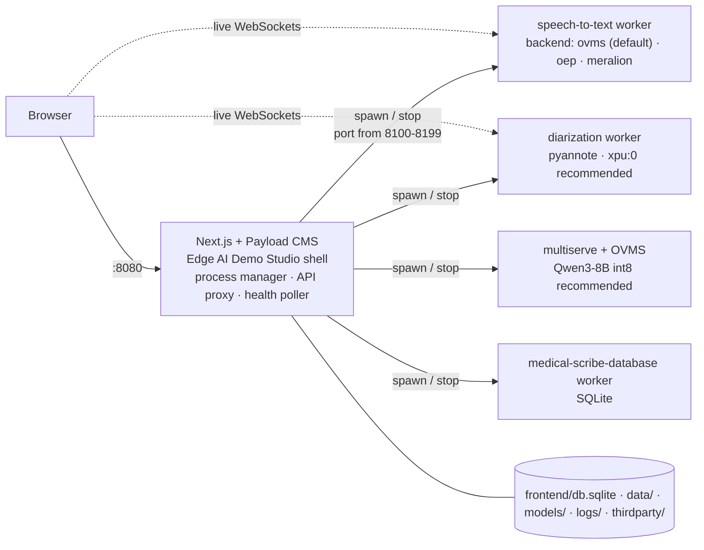

# Medical Scribe: High-Level Design, original app (as exported)

| | |
|---|---|
| Source | Edge AI Demo Studio export: `edge-developer-kit-reference-scripts/samples/ai/edge-ai-demo-studio`, `./export.sh --samples=medical-scribe` |
| Location | `/home/intel/sachin/health/medical-scribe` (exported 2026-11-25) |
| Platform | Ubuntu 24.04 or Windows 11, Intel CPU / GPU / NPU |
| Deployment | Native processes, no containers |

Related: [HLD of the containerized app](high-level-design.md), [architecture proposal](architecture-proposal.md). Diagram: page "Original app" in [_assets/medical-scribe-hld.drawio](_assets/medical-scribe-hld.drawio).

## 1. What it is

- A subset of **Edge AI Demo Studio**: the studio shell, the Medical Scribe sample, and the four services it needs. The export manifest lists them:
  - medical-scribe-database;
  - speech-to-text;
  - diarization;
  - text-generation.
- The **frontend starts and stops every service itself**, as a native process, when the user clicks Start in the UI.

## 2. Architecture

## 3. Components

| Component | Technology | Notes |
|---|---|---|
| Frontend / studio shell | Next.js 16, Payload CMS (SQLite `frontend/db.sqlite`), Node 24 | Dashboard, Services, Samples, System, Settings. Medical Scribe runs at `/samples/medical-scribe/demo`. |
| Process manager | Inside the frontend (`lib/workers/*`) | Starts each worker with `start.sh`, gives it a port from **8100–8199**, polls its health check, stops it |
| speech-to-text | `workers/services/speech-to-text/{ovms,oep,meralion}` | **Default backend `ovms`** (OpenVINO Model Server worker: Whisper or Qwen3-ASR). `oep` (audio-analyzer) and `meralion` are options. |
| diarization | `workers/services/diarization` | pyannote `speaker-diarization-community-1`; doctor voice embeddings |
| text-generation | `workers/engines/multiserve` | multiserve in front of OVMS or llama.cpp; OpenAI-compatible chat |
| medical-scribe-database | `workers/services/medical-scribe-database` | FastAPI + SQLite: sessions and doctor profiles |
| helper | `workers/services/helper` | Shared helper worker included by the export |

Sample defaults (`frontend/src/samples/medical-scribe/data.ts`):

| Service | Recommended model | Device |
|---|---|---|
| Speech to Text | `openai/whisper-large-v3-turbo` | GPU.0 |
| Diarization | `pyannote/speaker-diarization-community-1` | xpu:0 |
| Text Generation | `OpenVINO/Qwen3-8B-int8-ov` | GPU.0 |

## 4. Set-up and run

1. `sudo ./install_dependencies.sh`: system packages and GPU/NPU drivers.
2. `./setup.sh` (`setup_win.bat` on Windows): Node, FFmpeg, qmassa (GPU usage), pci.ids, uv, OVMS.
3. `./start.sh` (`start_win.bat`): the UI at http://127.0.0.1:8080.
4. In the UI:
   - set the Hugging Face token in **Settings**;
   - open **Samples → Medical Scribe**;
   - **Prepare this sample** starts the four services.
   - Worker environments and OEP sources are prepared on first start, so the first start takes longer.

## 5. Flows

- Same as the containerized app: upload or live → transcription → diarization → alignment in the browser → save → SOAP note streamed → save. See [HLD §4](high-level-design.md#4-main-flows).
- With the default `ovms` backend, live mode uses WebSocket `/v1/audio/stream` instead of the audio-analyzer's `/v1/realtime`.

## 6. Data

| Data | Where |
|---|---|
| UI state, services, settings, Hugging Face token (encrypted) | `frontend/db.sqlite` |
| Encounters, SOAP notes, doctor profiles | `data/medical-scribe-database/<instance>/medical_scribe.db` |
| Models | `models/` |
| Logs | `logs/` |
| Tools (Node, FFmpeg, qmassa, uv, OVMS) | `thirdparty/`, `workers/thirdparty/` |

## 7. Characteristics

| Strength | Limitation |
|---|---|
| One command to run; no Docker needed | Not a container deployment, unlike the other HLS suite apps |
| Runs on Linux and Windows | Depends on host packages and drivers (`install_dependencies.sh` needs sudo) |
| Any model or device can be changed in the UI | Services are started by hand from the UI; ports change between runs (8100–8199) |
| Full hardware view (CPU, GPU via qmassa, NPU, memory) | Generic studio UI (services, samples, start/stop) rather than a clinician app |
| Many STT backends to choose from | Default STT is the built-in OVMS worker, not the OEP audio-analyzer |
| | No user login; relies on 127.0.0.1-only binding |

## 8. Original vs containerized

| Area | Original (as exported) | Containerized (this repo) |
|---|---|---|
| Deployment | Native processes started by the UI | 5 containers, `make up` |
| Who starts services | Frontend process manager, on user click | Docker Compose; the UI uses them through `EXTERNAL_SERVICES` |
| Ports | Dynamic, 8100–8199 | Fixed: 8190 STT, 8191 diarization, 8192 LLM, 8193 DB |
| Speech to text | `ovms` worker (default) | `oep`: OEP audio-analyzer |
| Text generation model | Qwen3-8B int8 (recommended) | Qwen3.5-4B int4, from `deployment.json` |
| Diarization device | xpu:0 (recommended) | CPU (xpu not yet validated in a container) |
| Service setup | By hand in the UI | `deployment.json`, applied on every start |
| UI | Edge AI Demo Studio: Dashboard, Services, Samples, System, Settings | Medical Scribe: Today, Consultations, System (`APP_MODE=medical-scribe`) |
| Hugging Face token | UI Settings (encrypted in the database) | `docker/.env` |
| Hardware metrics | In-app: CPU, memory, GPU (qmassa), NPU | CPU, memory, NPU; GPU pending (performance-tools proposed) |
| Windows | Supported | Native path still used on Windows |
