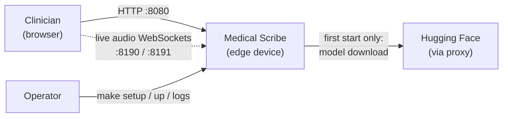
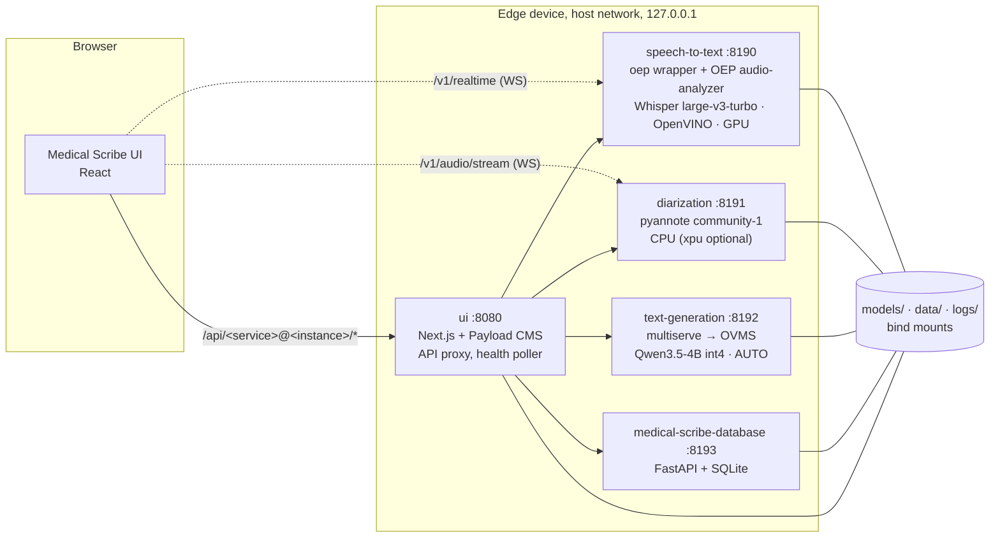
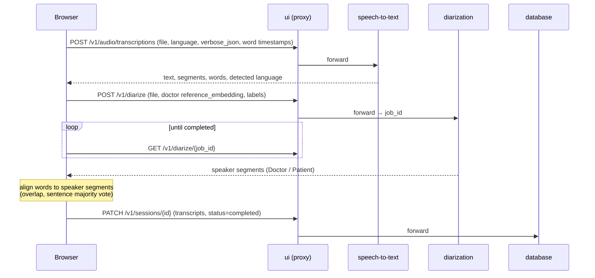

# Medical Scribe: High-Level Design (HLD)

| | |
|---|---|
| Product | Medical Scribe, Health and Life Sciences AI Suite |
| Platform | Intel Core Ultra (Arrow Lake): CPU, integrated GPU, NPU |
| Deployment | Docker Compose (`make up`), or native (`./setup.sh`, `./start.sh`) |
| Status | Containerized and running; UI step 1 done; metrics integration proposed |

Related: [architecture proposal](architecture-proposal.md), [changes summary](changes-summary.md), [containerization plan](containerization-plan.md).

Diagrams (draw.io): [_assets/medical-scribe-hld.drawio](_assets/medical-scribe-hld.drawio): pages "Architecture", "Consultation flow" and "Original app".

Original app (as exported from Edge AI Demo Studio): [high-level-design-original.md](high-level-design-original.md), with a side-by-side comparison.

## 1. Purpose and scope

- Records or uploads a doctor–patient consultation and produces:
  - a **transcript**, labelled Doctor / Patient;
  - a **SOAP note**: Subjective, Objective, Assessment, Plan.
- All AI runs **on the device**: no cloud calls once the models are downloaded.
- In scope: speech to text, speaker diarization with doctor voice enrolment, SOAP note generation, encounter storage, hardware monitoring.
- Out of scope (today): user login, EHR integration, multi-site deployment, video.

## 2. Context

- The browser runs on the same machine; every service listens on `127.0.0.1` only.
- Internet is only needed to build the images and to download models on first start.

## 3. Architecture

### 3.1 Components

| Component | Image | Technology | Responsibility |
|---|---|---|---|
| **ui** | `medical-scribe-ui` | Next.js 16, Payload CMS (SQLite), Node 24 | Clinician UI (Today, Consultations, System); proxies API calls to the services; polls their health; applies `deployment.json`; streams the SOAP note |
| **speech-to-text** | `medical-scribe-stt` | OEP audio-analyzer (`edge-ai-libraries` `2026.2.1`) + `oep` wrapper; OpenVINO GenAI | Batch and live transcription with word timestamps; language auto-detection |
| **diarization** | `medical-scribe-workers` | FastAPI, PyTorch, `pyannote/speaker-diarization-community-1` | Who spoke when; speaker embeddings for doctor enrolment; live diarization |
| **text-generation** | `medical-scribe-workers` | multiserve (FastAPI) in front of OpenVINO Model Server | OpenAI-compatible chat completions; model download and load on request |
| **medical-scribe-database** | `medical-scribe-workers` | FastAPI, SQLite | Encounters (sessions, transcripts, SOAP notes) and doctor profiles |

### 3.2 Design decisions

| Decision | Reason |
|---|---|
| One container per service | Independent restart, logs and health; matches the other suite apps |
| Host networking, fixed ports 8190–8193 | Live mode: the browser opens WebSockets **directly** to the STT and diarization ports. The ports must be in the app's instance range (8100–8199). |
| `EXTERNAL_SERVICES` env in the UI | The UI uses the containers without starting or stopping them; no database schema change |
| OEP audio-analyzer for STT | Reuse the Open Edge Platform microservice; the wrapper adds only the app contract |
| Separate pyannote diarization | audio-analyzer's diarization has no doctor voice enrolment |
| `APP_MODE=medical-scribe` | One image serves the clinician app or the original Demo Studio UI |
| One multi-stage Dockerfile | Shared driver/runtime base; 3 images |

## 4. Main flows

### 4.1 Upload a recording

- Speaker alignment runs in the browser (`samples/medical-scribe/lib/alignment/align.ts`).
- The Doctor label comes from cosine similarity between the enrolled doctor embedding and the speaker segments (`speakerMatchThreshold`).

### 4.2 Live consultation

- The browser captures the microphone and sends the same audio to:
  - speech-to-text, over WebSocket `/v1/realtime` (OpenAI Realtime-style);
  - diarization, over WebSocket `/v1/audio/stream`.
- These WebSockets go **directly** to ports 8190 / 8191, not through the UI proxy.
- On stop: the last utterance is flushed, and the full recording goes through batch diarization (flow 4.1). The live transcript is reused, not transcribed again.

### 4.3 SOAP note

- The browser sends the speaker-labelled transcript to the UI route `/api/services/text-generation/chat`.
- The UI calls multiserve's OpenAI-compatible `/v1/chat/completions`, which runs on OVMS.
- The note **streams** back into the editor and is saved with `PATCH /v1/sessions/{id}` (`soapReport`).
- The prompt (`samples/medical-scribe/lib/soap.ts`):
  - has four sections;
  - says "Not discussed" when a section has nothing;
  - does not allow invented findings;
  - writes English output, while the transcript may be mixed-language;
  - runs with reasoning disabled.

### 4.4 Doctor enrolment

- The clinician records a short voice sample (≥ 3 s).
- `POST /v1/embedding` on diarization returns a speaker embedding.
- `PATCH /v1/doctor-profiles/{id}` stores it in the database.

### 4.5 Start-up

1. `make up` starts the five containers. The UI waits for the database and text-generation to be healthy.
2. The UI applies `deployment.json` (every start). It creates and configures the four service records, using the fixed ports from `EXTERNAL_SERVICES`.
3. The UI asks multiserve to download and load `OpenVINO/Qwen3.5-4B-int4-ov`.
4. The health poller marks each service **active** once its health check answers. The Consultations page opens when all four are active.

## 5. Interfaces

| Service | Main endpoints |
|---|---|
| speech-to-text (8190) | `POST /v1/audio/transcriptions` (json, text, verbose_json, srt, vtt); `WS /v1/realtime`; `GET /v1/models`; `GET /healthcheck` (503 until the model is exported and warm) |
| diarization (8191) | `POST /v1/diarize` → `job_id`; `GET /v1/diarize/{id}` (+ `/events` SSE); `DELETE /v1/diarize/{id}`; `POST /v1/embedding`; `WS /v1/audio/stream`; `GET /healthcheck` |
| text-generation (8192) | `POST /v1/chat/completions`; `GET /v1/health`, `/v1/status`; `POST /v1/model/download/unverified`, `/v1/start`, `/v1/stop` |
| database (8193) | `GET/POST /v1/sessions`, `PATCH/DELETE /v1/sessions/{id}`; `GET/POST /v1/doctor-profiles`, `PATCH/DELETE /v1/doctor-profiles/{id}`; `GET /healthcheck` |
| ui (8080) | Pages `/`, `/samples/medical-scribe/demo`, `/system-monitoring`; proxy `/api/<type>@<instanceId>/*` → `127.0.0.1:<port>/*`; `/api/system-monitoring` |

## 6. Data

| Data | Where (host) | Notes |
|---|---|---|
| Encounters, transcripts, SOAP notes, doctor profiles + voice embeddings | `data/medical-scribe-database/medical-scribe-database/medical_scribe.db` | Clinical data (PHI). SQLite. |
| UI state: service records, settings | `data/ui/db.sqlite` | Tied to `PAYLOAD_SECRET` in `docker/.env` |
| Models (≈ 5.8 GB) | `models/`: `stt` 0.8 GB, `huggingface` 1.6 GB, `multiserve` 3.4 GB, `diarization` 33 MB | Shared with the native run; downloaded on first start |
| Logs | `logs/` | Per service |
| Secrets | `docker/.env` (git-ignored, mode 600) | `PAYLOAD_SECRET`, `HF_TOKEN` |

## 7. Deployment

- **Images** (local build): `medical-scribe-ui` 9.5 GB, `medical-scribe-workers` 7.7 GB, `medical-scribe-stt` 4.6 GB.
- **Commands:** `make setup` → set `HF_TOKEN` in `docker/.env` → `make build` → `make up`. Then `make status`, `make logs SERVICE=…`, `make down`.
- **Configuration** (`docker/.env`):
  - ports;
  - `STT_MODEL`, `STT_DEVICE`, `STT_PRECISION`;
  - `DIARIZATION_DEVICE`;
  - `APP_MODE`;
  - `HF_TOKEN`;
  - device group ids and NPU device.
- **Model and device** for each service: `deployment.json`, applied on every start.
- **Native mode:** `./setup.sh` + `./start.sh` with `APP_MODE` unset. The UI then starts the services itself as processes. This is the path on Windows.

## 8. Non-functional

| Area | Design |
|---|---|
| **Privacy** | Audio and notes stay on the device; services listen on `127.0.0.1` only; no telemetry (`NEXT_TELEMETRY_DISABLED`) |
| **Security** | Non-root containers (uid 1000); pinned, checksum-verified downloads; secrets only in git-ignored `docker/.env`; health-check URLs and proxied ports validated (instance range only). **No user login**: access control relies on local-only binding. |
| **Availability** | `restart: unless-stopped`; healthchecks on every container; the UI shows a read-only "Getting the AI ready" panel until all services are up |
| **Performance** | Whisper on GPU (int8); LLM on AUTO; diarization on CPU. Hardware view: System page (CPU, memory, NPU today; GPU needs `qmassa` in the image). First start: model export and download take minutes. |
| **Portability** | GPU/NPU user-space drivers pinned in the image (same as upstream audio-analyzer); host needs `/dev/dri`, `/dev/accel` and Docker |
| **Maintainability** | Upstream audio-analyzer pinned in `workers/upstream.json`; frontend changes kept small (`EXTERNAL_SERVICES`, `APP_MODE`) to limit drift from Demo Studio exports |

## 9. Risks and open items

| Item | Impact | Plan |
|---|---|---|
| No user authentication | Anyone with local access can read clinical data | Add login before any multi-user or remote use; for remote access put a TLS reverse proxy with auth in front |
| GPU usage missing on the System page in containers | Incomplete hardware view | Adopt performance-tools `metrics-collector` (see architecture proposal) or add `qmassa` to the UI image |
| No per-stage AI timings | Cannot show STT / diarization / LLM latency | Record per-encounter timings; show them on the System page |
| `HF_TOKEN` needed on every diarization start | Start fails without it | Load from cache offline once downloaded |
| Diarization on CPU only in containers | Slower for long recordings | Validate `xpu` in the image |
| text-generation healthy before its model is loaded | Brief window where notes fail | Readiness that includes the model |
| Re-export from Demo Studio overwrites local changes | Lost features | Upstream `EXTERNAL_SERVICES` and `APP_MODE` |
| Corporate proxy TLS interception during builds | Intermittent build failures | Retries (in place); optional corporate CA build secret |
| Large images (≈ 22 GB total) | Slow distribution | CPU/GPU variants, shared base layers, registry publishing |

## 10. Roadmap

1. Performance metrics: performance-tools collector plus per-encounter AI timings on the System page.
2. Encounter review screen (transcript and SOAP side by side, mark reviewed, export) and an Encounters table.
3. Model pre-download step (`make download-models`); diarization on `xpu`.
4. Release: publish images, SBOM, third-party notices, CI smoke test with the sample recordings.
5. Authentication before any shared or remote deployment.
