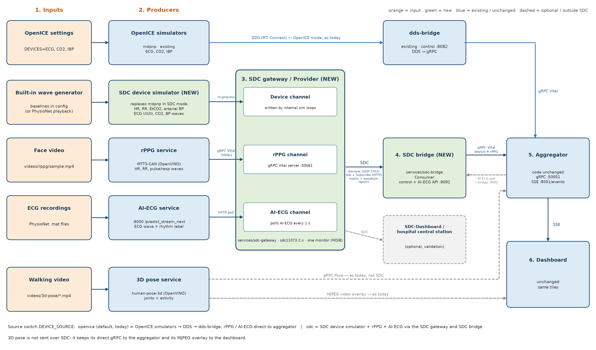
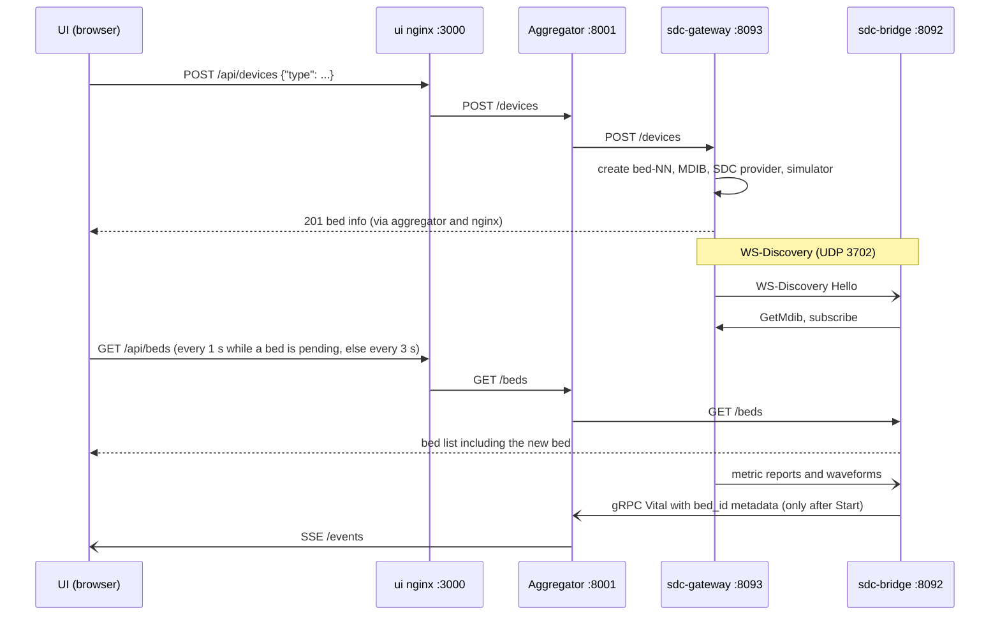

# SDC Device Source (IEEE 11073 SDC)

The application can get bedside-monitor data from either of two sources:

| `DEVICE_SOURCE` | Device data path | Services started |
|---|---|---|
| `openice` (default) | OpenICE simulators → DDS → `dds-bridge` → aggregator | `mdpnp`, `dds-bridge` |
| `sdc` | SDC device simulator → `sdc-gateway` → SDC → `sdc-bridge` → aggregator | `sdc-gateway`, `sdc-bridge` |

Both paths deliver the same metrics to the aggregator under the same names. The single-patient
workload view therefore works the same in either mode. SDC mode also adds several simulated beds
and a **Central station** view (see [Multiple Beds](#multiple-beds)).

## Run in SDC Mode

```bash
make run DEVICE_SOURCE=sdc                  # registry images
make run REGISTRY=false DEVICE_SOURCE=sdc   # build images locally
make down                                   # stops both openice and sdc services
```

To make SDC the default, set `DEVICE_SOURCE=sdc` in `configs/device.env`. A value passed on the
`make` command line overrides the file.

In SDC mode, `mdpnp` and `dds-bridge` are not started. The UI's device panel still uses the
workload name `mdpnp`, but that is only the name of the aggregator's device-data workload. The
data comes from the SDC gateway's built-in simulator.

## Architecture



1. **Producers**
   - The SDC device simulator inside `sdc-gateway` replaces the OpenICE simulated monitor. For
     each bed it generates HR, RR, SpO2, temperature, EtCO2 and arterial blood pressure, plus
     ECG lead II (250 Hz), plethysmograph (100 Hz), CO2 (20 Hz) and arterial pressure (120 Hz)
     waveforms.
   - The rPPG service sends its vitals to `sdc-gateway` on gRPC port 50061 instead of
     sending them straight to the aggregator.
   - `sdc-gateway` polls the AI-ECG service (`:8000/predict_stream_next`) for the ECG strip,
     the rhythm label and the inference latency.
2. **SDC gateway (providers).** `sdc-gateway` publishes each bed on the network as its own
   IEEE 11073 SDC provider (`sdc11073` 2.x), with the location `fac=MMPM;poc=ICU;bed=bed-NN`.
   The handles and UCUM units follow the convention that SDC central stations such as the
   SDC-Dashboard read. A bed's device model (MDIB) contains:

   | VMD | Channel | Handles | Source | Beds |
   |---|---|---|---|---|
   | `vmd.device` | `ch.ecg` | `numeric.hr`, `numeric.rr`, `wave.ecg_ii` | Built-in simulator | all |
   | | `ch.spo2` | `numeric.spo2`, `wave.pleth` | Built-in simulator | all |
   | | `ch.temp` | `numeric.temp` | Built-in simulator | all |
   | | `ch.co2` | `numeric.etco2`, `numeric.rr_co2`, `wave.co2` | Built-in simulator | all |
   | | `ch.ibp` | `numeric.nibp_sys` / `_dia` / `_map` (arterial-line codes), `wave.abp` | Built-in simulator | all |
   | `vmd.video` | `ch.video` | `string.video_stream_url` | Camera URL | multimodal |
   | `vmd.rppg` | `ch.rppg` | `numeric.rppg_hr`, `numeric.rppg_rr`, averages, `wave.rppg`, `wave.rppg_resp` | rPPG service | `bed-01` |
   | `vmd.aiecg` | `ch.aiecg` | `wave.ai_rhythm_strip` (360 Hz), `string.ai_rhythm`, `string.ai_rhythm_source`, `numeric.ai_rhythm_latency` | AI-ECG service | `bed-01` |

   Numerics update once per second. Waveforms are sent as real-time sample arrays in 200 ms
   chunks.
3. **SDC transport.** Consumers find the beds with WS-Discovery (UDP 3702), read each
   MDIB with `GetMdib`, and subscribe to episodic metric reports and waveform streams over HTTP.
4. **SDC bridge (consumer).** `sdc-bridge` subscribes to every bed in the `MMPM` facility and
   converts each update into the existing gRPC `Vital` messages for the aggregator (`:50051`):
   - **Device metrics** use the same names and device types as `dds-bridge`. Device IDs are
     `<bed>-ecg`, `<bed>-spo2`, `<bed>-temp`, `<bed>-co2` and `<bed>-ibp`, and each vital
     carries the `bed_id` and `primary` metadata. They are sent only after the aggregator calls
     `POST /start`. Waveforms are sent in 1 s windows.
   - **rPPG metrics** from `bed-01` are always sent, as device `rppg-001`.
   - **AI-ECG results** from `bed-01` are served on `GET /predict_stream_next`, which the
     aggregator polls instead of calling the AI-ECG service directly.
5. **Aggregator and UI.** In SDC mode, `run_compose.sh` points the aggregator's device-control
   URL and AI-ECG URL at `sdc-bridge` (`:8092`). The aggregator adds `bed_id` and `primary` to
   device events. The UI's single-patient workload view shows only `bed-01`, and the
   **Central station** view shows every bed.

3D pose is not sent over SDC. It keeps its direct gRPC connection to the aggregator and its
MJPEG video overlay to the UI. Multimodal beds publish the pose MJPEG URL as their camera.

## Multiple Beds

`sdc-gateway` always starts `bed-01`. This is a multimodal monitor that carries the live rPPG
and AI-ECG workloads, and it cannot be removed. You can add more simulated beds of two kinds:

| Type | What it publishes |
|---|---|
| `monitor` | Multiparameter patient monitor: ECG, SpO2/pleth, temperature, capnography, arterial BP |
| `multimodal` | Monitor plus a room-camera URL (`string.video_stream_url`) |

Each simulated bed starts from its own baselines. Add beds in either of these ways:

```bash
make run REGISTRY=false DEVICE_SOURCE=sdc SDC_EXTRA_DEVICES=monitor,monitor,multimodal
```

You can also add or remove beds at run time from the **Central station** view in the UI, or
through the aggregator:

```bash
curl -s http://localhost:8001/devices                                    # simulated beds
curl -s -X POST http://localhost:8001/devices -H 'Content-Type: application/json' -d '{"type":"monitor"}'
curl -s -X DELETE http://localhost:8001/devices/bed-02
curl -s http://localhost:8001/beds                                       # beds sdc-bridge is subscribed to
```

`sdc-bridge` picks up a new bed as soon as it announces itself with WS-Discovery Hello
(usually 1–2 s). It drops removed beds when they send WS-Discovery Bye or end their
subscriptions. A full probe every 5 s catches any announcement that was missed. Any other SDC provider in
facility `MMPM` that uses the codes below also appears as a bed. Because the handles follow the
SDC-Dashboard convention, the SDC-Dashboard central station can show the gateway's beds too.

| Variable | Default | Description |
|---|---|---|
| `SDC_EXTRA_DEVICES` | empty | Beds to create at start-up besides `bed-01` |
| `SDC_MAX_DEVICES` | `16` | Maximum number of beds |
| `VIDEO_STREAM_URLS` | `http://<host>:8085/video_feed` | Comma-separated camera URLs, given to multimodal beds in turn |
| `SDC_FACILITY` | `MMPM` | Facility in the bed location. The bridge uses only providers in this facility |

### What Happens When You Add a Device

The **Central station** view has two buttons in its devices panel:

- **+ Patient monitor** adds a bed of type `monitor`.
- **+ Multimodal monitor** adds a bed of type `multimodal`.

Both buttons follow the same path through the system. The table in
[Patient Monitor vs. Multimodal Monitor](#patient-monitor-vs-multimodal-monitor) lists where
they differ.



#### Step 1: The UI sends the request

1. The devices panel (`CentralStation/DevicesPanel.tsx`) appears only when `GET /api/beds`
   succeeds, which happens only in SDC mode. In OpenICE mode, the view shows a message
   instead of the buttons. The buttons are disabled until **Start** is pressed. Bed tiles,
   and with them the ✕ remove buttons, are also shown only while running, so beds can be
   added or removed only after Start. Beds created at start-up through `SDC_EXTRA_DEVICES`
   are not affected.
2. A click calls `onAdd('monitor')` or `onAdd('multimodal')` in
   `CentralStation/CentralStation.tsx`.
3. While the request runs, both buttons are disabled, the clicked one shows a spinner and
   *Adding…*, and any previous error message is cleared.
4. `api.addDevice()` (`services/api.ts`) sends `POST /api/devices` with the body
   `{"type": "monitor"}` or `{"type": "multimodal"}`.
5. nginx in the `ui` container strips the `/api/` prefix and forwards the request to the
   aggregator at `http://host.docker.internal:8001/devices`.

#### Step 2: The aggregator forwards the request

6. `POST /devices` checks that the body is a JSON object whose `type` is `monitor` or
   `multimodal`. Any other body gets a `422` response, and the gateway is not called.
7. The aggregator sends `POST /devices` to the gateway at `SDC_GATEWAY_URL`
   (default `http://localhost:8093`). It uses a 10 s timeout and runs the call in a worker
   thread, so the SSE stream is not blocked.
8. The aggregator passes the gateway's status code and JSON body back to the UI. If the
   gateway cannot be reached, the aggregator returns `502`.

#### Step 3: The gateway creates the bed

The gateway's management API listens only on `127.0.0.1:8093`, so only the aggregator on the
same host can reach it.

9. FastAPI checks the `type` again and returns `422` if it is invalid.
10. `DeviceManager.add(type)` runs with `ai=False` and `primary=False`. A bed added from the
    UI is never the primary bed and never carries rPPG or AI-ECG data. Only `bed-01` does.
11. The manager holds a lock while it adds the bed, so two clicks at the same time get
    different bed IDs.
12. **Limit check.** If the gateway already has `SDC_MAX_DEVICES` beds (default 16), it
    returns `409` with `device limit reached (16)`. `bed-01` counts toward the limit.
13. **Bed ID.** The manager picks the lowest free `bed-NN`, so the ID of a removed bed is
    used again.
14. **EPR (endpoint reference).** The EPR is `urn:uuid:` followed by
    `uuid5(NAMESPACE_URL, "mmpm-sdc/<facility>/<bed-id>")`. The same bed ID always gets the
    same EPR, even after a restart, so SDC consumers recognize the bed.
15. **Serial number.** `MMPM-NNNN`, taken from the bed number.
16. **Camera URL (multimodal only).**
    - The gateway takes the next URL from `VIDEO_STREAM_URLS` in round-robin order.
    - The default list has a single entry, `http://<host-ip>:8085/video_feed`, which is the
      3D-pose MJPEG stream. With the default, every multimodal bed shows the same camera.
    - A `monitor` bed gets no URL.
17. **Device model (MDIB).** The gateway builds the MDIB from `vmds_for(type, ai=False)`:
    - `monitor`: `vmd.device` (ECG, SpO2/pleth, temperature, CO2 and arterial pressure
      channels).
    - `multimodal`: `vmd.device` and `vmd.video` (`string.video_stream_url`).

    Each metric uses its IEEE 11073-10101 code and a UCUM unit, as listed in the
    [Architecture](#architecture) table.
18. **SDC provider.** The gateway creates an `SdcProvider` that shares the gateway's
    WS-Discovery instance. It has:
    - Manufacturer `Intel`.
    - Model name `MMPM Patient Monitor` or `MMPM Multimodal Monitor`.
    - Friendly name `<model name> bed-NN`.
    - The serial number from step 15.

    TLS is used when `SDC_SSL_DIR` is set.
19. The provider starts its own HTTP endpoint on a free port.
20. For a multimodal bed, the gateway writes the camera URL into `string.video_stream_url`.
21. The gateway sets the location to `fac=MMPM;poc=ICU;bed=bed-NN`. This announces the
    provider on WS-Discovery with the location scope, so consumers can find it.
22. **Simulator.** If `SIM_ENABLED` is true (the default), a `DeviceSimulator` starts for
    the bed.
    - It draws its own random baselines, so beds don't look identical:

      | Vital | Baseline range |
      |---|---|
      | HR | 64–88 /min |
      | RR | 12–18 /min |
      | SpO2 | 95–99 % |
      | Temperature | 36.4–37.4 °C |
      | EtCO2 | 33–40 mmHg |
      | Systolic pressure | 108–132 mmHg |
      | Diastolic pressure | 68–84 mmHg |

    - A numeric thread updates HR, RR, SpO2, temperature, EtCO2, CO2 respiration rate and
      systolic/diastolic/mean pressure once per second.
    - A waveform thread sends 200 ms chunks of ECG lead II (250 Hz), pleth (100 Hz),
      CO2 (20 Hz) and arterial pressure (120 Hz).
    - The simulator runs from this point on. Whether its data reaches the UI depends on
      **Start** (see Step 6).
23. If steps 20–22 fail, the provider is stopped and the request returns an error.
24. The gateway logs `added <type> bed-NN (<epr>, ai=False, video=<url or ->)` and returns
    `201` with `bed_id`, `type`, `ai`, `primary`, `epr`, `serial`, `video_url` and `created`.

#### Step 4: The UI handles the response

25. On success, the UI remembers the returned `bed_id` as *pending* and shows the wait:
    - A spinner with *Adding bed-NN (Patient monitor)…* or
      *Adding bed-NN (Multimodal monitor)…* appears next to the buttons.
    - While running, a dashed placeholder tile with a spinner appears in the grid.
    - The UI polls `GET /api/beds` every 1 s, instead of every 3 s, until no bed is pending.
26. On failure, the error's `detail` text, for example `device limit reached (16)`, appears
    in red next to the buttons.
27. The bed list comes from `sdc-bridge`, not from the gateway. The new bed therefore
    appears, and the bed count goes up, only after the bridge subscribes to it in Step 5.
    The pending indicators then disappear. If the bed isn't listed within 30 s, they
    disappear anyway and the panel shows *bed-NN not discovered yet. Check the sdc-bridge
    logs.*

#### Step 5: sdc-bridge discovers and subscribes

28. The bridge listens for WS-Discovery Hello messages from SDC medical devices and handles
    each one immediately. As a fallback, if nothing was announced for 5 s, it clears its
    WS-Discovery cache, probes for SDC medical devices, and waits 3 s for answers.
29. The bridge ignores providers whose location facility is not `SDC_FACILITY`.
30. For an EPR it does not know yet, the bridge takes the bed ID from the location
    (`bed-NN`). If another provider already uses that ID, the bridge adds `-2`, `-3` and so on.
31. The bridge opens an SDC consumer, reads the MDIB (`GetMdib`), and subscribes to episodic
    metric reports and waveform streams.
32. The translator maps the descriptors by code: 13 metrics for a monitor, and 14 for a
    multimodal bed (the extra one is the camera URL). Because the bed is not primary, rPPG
    and AI-ECG descriptors are skipped.
33. For a multimodal bed, the translator reads the camera URL from the MDIB.
34. The bridge logs `subscribed to SDC provider bed-NN (<epr>)`.

The new bed usually appears in the UI 1–3 s after the click.

#### Step 6: The tile appears and data flows

35. The next `/api/beds` poll goes through the aggregator to the bridge's `GET /beds`, which
    lists the bed with `type`, `ai=false`, `primary=false`, `video_url`, `location` and
    `connected=true`.
36. `setBeds` (`redux/slices/bedsSlice.ts`) stores the list. While the application is running,
    the grid replaces the placeholder with a tile (`CentralStation/BedTile.tsx`).
    - The tile shows the **Monitor** or **Multimodal** badge. It has no **AI** or
      **Primary** badge.
    - The tile has a ✕ button, because only non-primary beds can be removed. Clicking it
      covers the tile with *Removing bed-NN…* until the bridge drops the bed, usually within
      1–3 s.
37. A green dot means the bridge's subscription is connected.
38. Until data arrives, the tile is dimmed and the numerics show `--`.
39. The bridge forwards device data only after **Start** is pressed in the UI. Start makes
    the aggregator call the bridge's `POST /start`. Until then, the view shows only the
    devices panel, with the add buttons disabled, and *Press Start to stream vitals from the
    beds and to add or remove beds*. No tiles are shown. Because the buttons work only after
    Start, the new bed's data flows as soon as the bridge subscribes.
40. **Numerics.** Each update becomes a gRPC `Vital` sent to the aggregator (`:50051`).
    - Device IDs are `bed-NN-ecg`, `bed-NN-spo2`, `bed-NN-temp`, `bed-NN-co2` and
      `bed-NN-ibp`.
    - Each vital carries its `device_type` and the metadata `bed_id=bed-NN` and
      `primary=false`.
41. **Waveforms.** The bridge collects samples into 1 s windows before sending them: 250 ECG,
    100 pleth, 20 CO2 and 120 arterial pressure samples.
42. The aggregator adds `bed_id` and `primary` to each event and publishes it on SSE
    `/events` with `workload_type: "mdpnp"`.
43. `sseMiddleware.ts` maps the metric names to tile fields and dispatches `bedVital`, which
    updates `beds.live["bed-NN"]`.
44. Because `primary` is false, the event does not reach the single-patient MDPNP card in the
    workload view. Only `bed-01` feeds that card.
45. The tile shows:
    - HR, SpO2, RR, arterial pressure as systolic/diastolic (mean), temperature and EtCO2.
    - An ECG II strip.
    - A pleth strip (monitor) or the camera image (multimodal).
    - A CO2 strip.

    The arterial pressure waveform is received but not drawn on the tile.
46. If no update arrives for 5 s, the tile is dimmed again.
47. **Stop** removes all tiles and clears the live data. The camera connections close, and
    events that arrive after Stop are ignored. The beds stay connected and keep counting in
    *N beds*, and you can still add beds. Their tiles appear on the next **Start**.

#### Patient Monitor vs. Multimodal Monitor

| | + Patient monitor | + Multimodal monitor |
|---|---|---|
| Request body | `{"type": "monitor"}` | `{"type": "multimodal"}` |
| SDC model name | `MMPM Patient Monitor` | `MMPM Multimodal Monitor` |
| VMDs in the MDIB | `vmd.device` | `vmd.device`, `vmd.video` |
| `string.video_stream_url` | not present | next URL from `VIDEO_STREAM_URLS` |
| Metrics mapped by the bridge | 13 | 14 |
| Tile badge | Monitor | Multimodal |
| Middle row of the tile | Pleth waveform | Camera image |
| rPPG and AI-ECG | no | no (only `bed-01`) |
| Feeds the workload view's MDPNP card | no | no (only `bed-01`) |

**How the camera image is loaded:**

- If the camera URL uses port `8085`, the UI rewrites it to `/pose-stream/<path>`. nginx
  forwards that path to `:8085`, so the browser doesn't need direct access to the host port.
- Other `http` and `https` URLs are used as they are.
- If the URL is missing or invalid, the tile shows the pleth waveform instead.
- The browser opens one connection per camera URL, not per tile. `SharedVideo.tsx` loads each
  URL once in a hidden image and paints its frames into a canvas in every tile that uses it.
  Browsers animate only one of several `` tags that share an MJPEG URL, and each open
  stream also uses up one of the browser's six connections to the host.

#### Errors

| Situation | Returned by | What the UI shows |
|---|---|---|
| `type` is not `monitor` or `multimodal` | aggregator or gateway | `422` message next to the buttons |
| `SDC_MAX_DEVICES` beds already exist | gateway | `device limit reached (16)` |
| Gateway not running or unreachable | aggregator | `502`, `... unreachable` |
| Bridge cannot connect to the new provider | bridge (log: `cannot connect to SDC provider`) | Bed doesn't appear. The bridge tries again every round |

Beds added from the UI live only in the gateway's memory. They are gone after `sdc-gateway`
restarts, for example after `make down`. To create beds at every start-up, use
`SDC_EXTRA_DEVICES`.

## Settings Changed by SDC Mode

`run_compose.sh` sets these values when `DEVICE_SOURCE=sdc`:

| Variable | OpenICE mode | SDC mode | Used by |
|---|---|---|---|
| `COMPOSE_PROFILES` | `openice` | `sdc` | Docker Compose |
| `DEVICE_CONTROL_URL` | `http://localhost:8082` | `http://localhost:8092` | Aggregator (device start/stop) |
| `AGGREGATOR_AI_ECG_URL` | `http://localhost:8000/predict_stream_next` | `http://localhost:8092/predict_stream_next` | Aggregator (AI-ECG poll) |
| `RPPG_AGGREGATOR_PORT` | `50051` (aggregator) | `50061` (gateway) | rPPG gRPC client |

## Metric Mapping

`sdc-bridge` maps metrics by their coded type (coding system and code), not by handle. Any
SDC provider that uses these codes can feed the application.

| SDC code | Name sent to the aggregator | Device type |
|---|---|---|
| 147842 | `MDC_ECG_HEART_RATE` | `ECG_Simulator` |
| 151570 | `MDC_TTHOR_RESP_RATE` | `ECG_Simulator` |
| 131329 / 131330 / 131389 | `MDC_ECG_LEAD_I` / `_II` / `_III` | `ECG_Simulator` |
| 150456 | `MDC_PULS_OXIM_SAT_O2` | `PulseOx_Simulator` |
| 150452 | `MDC_PULS_OXIM_PLETH` | `PulseOx_Simulator` |
| 150364 | `MDC_TEMP_BODY` | `Temp_Simulator` |
| 151708 | `MDC_AWAY_CO2_ET` | `CO2_Simulator` |
| 151586 | `MDC_CO2_RESP_RATE` | `CO2_Simulator` |
| 151704 | `MDC_AWAY_CO2` | `CO2_Simulator` |
| 150037 / 150038 / 150039 | `MDC_PRESS_BLD_ART_ABP_SYS` / `_DIA` / `_MEAN` | `IBP_Simulator` |
| 150036 | `MDC_PRESS_BLD` | `IBP_Simulator` |
| `urn:intel:hls:mmpm` `RPPG_*` | `HEART_RATE`, `RESP_RATE`, `*_AVG` | rPPG |
| `urn:intel:hls:mmpm` `AIECG_*` | AI-ECG `signal`, `result`, `file`, `inference_ms` | AI-ECG |
| `urn:research:video` `VIDEO_STREAM_URL` | Bed camera URL (`/beds`, not sent as a vital) | — |

Codes without a coding system are IEEE 11073-10101 codes. Codes 151570, 151586 and 151704
must be confirmed against the NIST RTMMS term list before clinical use.

## Ports

| Port | Service | Purpose |
|---|---|---|
| UDP 3702 | `sdc-gateway`, `sdc-bridge` | WS-Discovery |
| Dynamic HTTP | `sdc-gateway` | SDC services (`GetMdib`, subscriptions), one port per bed |
| 50061 | `sdc-gateway` | rPPG gRPC input |
| 8093 (localhost) | `sdc-gateway` | Device-management API: `/devices` |
| 8092 | `sdc-bridge` | Control API: `/start`, `/stop`, `/status`, `/beds`, `/predict_stream_next`, `/health` |
| 50051 | Aggregator | gRPC `Vital` input (unchanged) |

All SDC services use host networking, so WS-Discovery multicast reaches the host's network
interface. Set `SDC_BIND_IP` if the host has more than one interface.

## Verify

```bash
docker ps --format '{{.Names}}'          # sdc-gateway and sdc-bridge, no mdpnp / dds-bridge
docker logs sdc-bridge | grep subscribed # "subscribed to SDC provider bed-01 (urn:uuid:..., primary)"
curl -s http://localhost:8092/beds       # every bed, with "connected": true
curl -s -X POST "http://localhost:8001/start?target=mdpnp"   # or start the device stream from the UI
timeout 5 curl -sN http://localhost:8001/events | grep -oE '"device_id": "[^"]+"' | sort | uniq -c
```

In the event stream, device-metric events have `workload_type` `mdpnp`, a `bed_id`, and a
`device_id` such as `bed-01-ecg` or `bed-02-spo2`. This shows the data came through SDC.

## Limitations

- **No TLS by default.** SDC traffic is unencrypted unless `SDC_SSL_DIR` points to a folder
  inside the containers that holds `userkey.pem`, `usercert.pem` and `cacert.pem`.
- **Synthetic device data.** All device data comes from the built-in simulator. The pressure
  values are published under the SDC-Dashboard's `numeric.nibp_*` handles but use the
  arterial-line codes.
- **Device-management API.** It has no authentication. It listens on `127.0.0.1:8093` only,
  and the aggregator's `/devices` proxy is as open as the aggregator itself.
- **One live patient.** Only `bed-01` carries the rPPG and AI-ECG workloads. Every
  multimodal bed shows the same pose camera unless `VIDEO_STREAM_URLS` lists more streams.
- **rPPG connects once.** The rPPG service connects to its gRPC target once at start-up. If
  `sdc-gateway` restarts, restart `rppg` too.

For per-service configuration, see `services/sdc-gateway/README.md` and
`services/sdc-bridge/README.md`.
