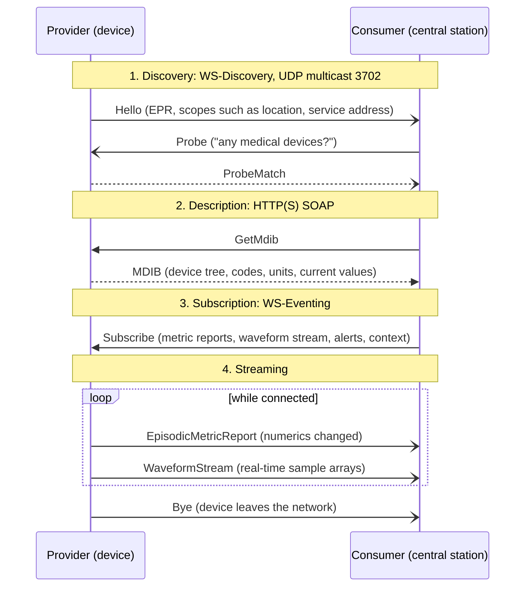
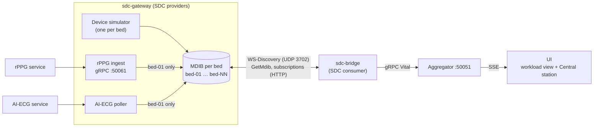
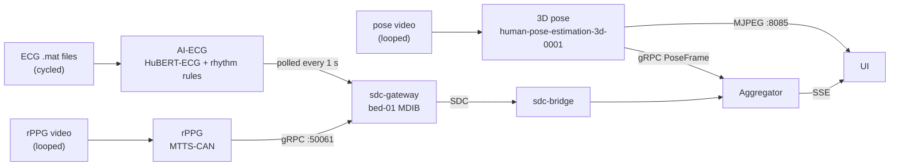

# SDC in MMPM: Simulator and Central Station

This page gives a short overview of how the Multi-Modal Patient Monitoring (MMPM) application
uses IEEE 11073 SDC, and how the built-in SDC simulator produces bedside-device data. It also
describes the two reference projects that MMPM's SDC support is modelled on: the SDC-MM-Simulator
and the SDC-Dashboard. For the full reference, see [SDC Device Source](./sdc-device-source.md).

## Why SDC

IEEE 11073 SDC (Service-oriented Device Connectivity) is the open standard for connecting
medical devices over an IP network. SDC devices:

- **Announce themselves** on the network with WS-Discovery, so no manual IP setup is needed.
- **Describe themselves** with a standard device model (the MDIB), in which every value has an
  IEEE 11073-10101 code and a UCUM unit.
- **Stream their data** to any subscriber: numerics as episodic reports and waveforms as
  real-time sample arrays.

In MMPM, SDC replaces the OpenICE/DDS path as the source of bedside-monitor data. Run
`make run DEVICE_SOURCE=sdc` to use it. This shows that an Intel edge system can act as a
**vendor-neutral, plug-and-play central station**:

| Customer value | What the demo shows |
|---|---|
| Interoperability | The application reads only standard codes and units. Any SDC device in the facility can feed it |
| Plug and play | A new bed is discovered and shown within about 1–3 s, with no configuration |
| Ward-scale consolidation | One edge box collects, normalizes and displays many beds (up to 16 by default) |
| Multimodal devices | Standard monitors and camera-enabled monitors share one Central station screen |
| AI at the edge | `bed-01` also carries rPPG (camera-based vitals) and AI-ECG results over SDC |

## How SDC Works

SDC has two roles. A **provider** is a medical device that offers data, for example a patient
monitor. A **consumer** is a system that uses the data, for example a central station. All
three projects on this page use the open-source `sdc11073` Python library for both roles.



1. **Discovery.** When a provider starts, it multicasts a WS-Discovery *Hello*. The Hello
   carries its endpoint reference (EPR, a stable `urn:uuid:` ID), its scopes (for example the
   location `fac=...;poc=...;bed=...`) and the HTTP address of its services. A consumer can also
   multicast a *Probe* for medical devices, and every provider answers. When a provider stops,
   it sends *Bye*.
2. **Description.** The consumer calls `GetMdib` and receives the provider's MDIB (Medical Device
   Information Base). This is a tree of MDS (the device), VMDs (sub-systems), channels and
   metrics. Each metric has a **handle** (a local name such as `numeric.hr`), a **code**
   (IEEE 11073-10101, for example `MDC_ECG_HEART_RATE`) and a **UCUM unit** (for example `/min`).
3. **Subscription.** The consumer subscribes to the reports it needs.
4. **Streaming.** In the provider, the application changes values inside an `sdc11073`
   transaction (`metric_state_transaction` for numerics, `rt_sample_state_transaction` for
   waveforms). When the transaction ends, `sdc11073` sends a report to every subscriber. On the
   consumer side, `sdc11073` updates its local copy of the MDIB and notifies the application.
5. **Security (optional).** Providers and consumers can use mutual TLS with X.509 certificates.

Because the codes and units are standard, a consumer can interpret data from any vendor's
device without vendor-specific drivers.

## Where the Simulator Fits

MMPM does not need any real medical hardware. The `sdc-gateway` service contains a
**built-in SDC simulator**, written with the open-source `sdc11073` Python library. Each
simulated bed is a full SDC provider on the network. The rest of the application can't tell it
apart from a real device.



The end-to-end architecture diagram is in
[SDC Device Source – Architecture](./sdc-device-source.md#architecture).

## How the Simulator Produces Data

Each bed gets its own `DeviceSimulator` (`services/sdc-gateway/sdc_gateway/simulator.py`). It runs
two threads that write into the bed's MDIB through `sdc11073` transactions. Each transaction
becomes an SDC report that every subscriber receives.

### Numerics (once per second)

Each vital has its own baseline, picked at random when the bed is created, so the beds in a
ward don't look identical. Each value then:

1. drifts slowly around its baseline (a sine wave with a period of 1.5–5 minutes),
2. gets small random jitter, and
3. is clamped to a plausible range.

| Vital | Baseline | Slow drift | Published as |
|---|---|---|---|
| Heart rate | 64–88 /min | ±6 | `numeric.hr` |
| Respiration rate | 12–18 /min | ±2 | `numeric.rr`, `numeric.rr_co2` |
| SpO2 | 95–99 % | ±1 | `numeric.spo2` |
| Temperature | 36.4–37.4 °C | ±0.2 | `numeric.temp` |
| EtCO2 | 33–40 mmHg | ±3 | `numeric.etco2` |
| Arterial pressure | 108–132 / 68–84 mmHg | ±8 / ±5 | `numeric.nibp_sys`, `_dia`, `_map` |

The diastolic pressure is kept at least 20 mmHg below the systolic pressure. The mean pressure
is calculated as diastolic + (systolic − diastolic) / 3. All values are published together in
one episodic metric report.

### Waveforms (every 200 ms)

The waveform thread creates a 200 ms chunk of samples for each waveform and publishes them in
one real-time sample report. The waveforms are generated from formulas, not replayed from
recordings, and they follow the current numerics:

| Waveform | Rate | How it is generated |
|---|---|---|
| ECG lead II (`wave.ecg_ii`) | 250 Hz | Sum of five Gaussian bumps for the P, Q, R, S and T waves, plus small noise. Beat rate = current HR |
| Pleth (`wave.pleth`) | 100 Hz | Arterial pulse shape (fast upstroke, decay, dicrotic notch), delayed 25 % of a beat after the R wave |
| Arterial pressure (`wave.abp`) | 120 Hz | The same pulse shape scaled between the current diastolic and systolic values |
| CO2 (`wave.co2`) | 20 Hz | Capnogram: baseline during inspiration, upstroke, plateau up to EtCO2, then a drop. Breath rate = current RR |

Beat and breath phases carry over from one chunk to the next, so the waveforms are continuous.
When the heart rate drifts, the ECG and pulse speed up or slow down with it.

### AI Data on the Primary Bed

`bed-01` is a multimodal monitor that also publishes real AI results, not simulated ones:

- **rPPG.** The rPPG service sends its heart rate, respiration rate and waveforms to the gateway
  over gRPC (`:50061`). The gateway writes them into `bed-01`'s `vmd.rppg`.
- **AI-ECG.** The gateway polls the AI-ECG service once per second and publishes the analysed
  strip (300 Hz), the rhythm label and the inference latency in `vmd.aiecg`.

So `bed-01` shows how AI results computed at the edge can be packaged as standard SDC metrics.

## How the AI Workloads Produce Data

The three AI workloads don't use real sensors either. Each one replays recorded input in a loop,
runs AI inference with OpenVINO, and sends its results onward.



The diagram shows SDC mode. In OpenICE mode, rPPG sends straight to the aggregator (`:50051`),
and the aggregator polls AI-ECG itself.

### rPPG: Vital Signs from a Face Video

| Stage | What happens |
|---|---|
| Input | `/videos/rppg/sample.mp4`, read at 30 fps and looped |
| Pre-processing | Each frame is cropped to the face region and resized to 36×36 pixels. Frames are processed in batches of 10 |
| Model | MTTS-CAN (Keras, converted to OpenVINO IR) on `RPPG_DEVICE` (default GPU). It extracts a pulse signal and a breathing signal from small changes in skin colour and motion |
| Post-processing | Band-pass filters: 0.75–2.5 Hz for pulse and 0.1–0.5 Hz for breathing. The FFT peak gives the rate: HR = peak frequency × 60 (45–150 /min), and RR the same way (6–30 /min) |
| Output | `HEART_RATE` and `RESP_RATE` with 30 Hz waveforms every 1 s, plus averages every 5 batches. Sent as gRPC `Vital` messages from device `rppg-001` |
| SDC mode | Sent to `sdc-gateway` (`:50061`) and published in `bed-01`'s `vmd.rppg` |
| Control | Aggregator calls `POST :8084/start` or `/stop` |

### AI-ECG: Rhythm Analysis of Recorded ECGs

| Stage | What happens |
|---|---|
| Input | Six single-lead ECG records (`A00001.mat` and so on) in `services/ai-ecg/backend/data`, in the PhysioNet/CinC 2017 AF-challenge format, sampled at 300 Hz |
| Trigger | Each call to `GET :8000/predict_stream_next` processes the next file, wrapping round after the last one |
| Model | HuBERT-ECG small (Hugging Face, converted to OpenVINO IR FP16) on `ECG_DEVICE`. The signal is truncated or zero-padded to 5000 samples. The model returns an embedding (a feature vector) and the inference time |
| Rhythm label | Signal-processing rules in `inference/signal_classifier.py`, not the HuBERT model (see below) |
| Output | JSON with `signal`, `result` (the label), `inference_ms`, `file` and `hubert_embedding` |
| SDC mode | `sdc-gateway` polls once per second and publishes the strip, label and latency in `bed-01`'s `vmd.aiecg`. The aggregator polls `sdc-bridge` instead of the AI-ECG service |

The rhythm rules work like this:

- R-peaks (heartbeats) are detected, and the RR intervals (time between beats) are measured.
- **Atrial Fibrillation** if the intervals are very irregular (coefficient of variation above
  0.18).
- **Normal Sinus Rhythm** if the rate is 45–110 /min and the intervals are regular.
- **Too Noisy** if fewer than 3 beats are found.
- **Other Rhythm** otherwise.

### 3D Pose: Body Pose and Activity from a Video

| Stage | What happens |
|---|---|
| Input | `/videos/3d-pose/face-demographics-walking.mp4`, about 20 fps, looped |
| Model | Open Model Zoo `human-pose-estimation-3d-0001` (OpenVINO IR) on `POSE_3D_DEVICE` (default GPU). It outputs 2D and 3D positions of 19 joints for each person, with a confidence per joint |
| Post-processing | Low-confidence poses are dropped. A rule in `pose_encoder.py` sets the activity from the shoulder–hip and hip–knee distances: Sitting, Standing, Walking or Moving |
| Output | A gRPC `PoseFrame` per frame (people, joints, activity) to the aggregator (`:50051`), and an MJPEG video with the skeleton drawn on it at `:8085/video_feed` |
| SDC mode | Unchanged. Pose data does not go through SDC. Multimodal beds publish the `:8085` video as their camera URL |
| Control | Aggregator calls `POST :8083/start` or `/stop` |

## Patient Monitor vs. Multimodal Monitor

| | Patient monitor | Multimodal monitor |
|---|---|---|
| Represents | Standard bedside monitor | Bedside monitor with a room camera |
| SDC model | `MMPM Patient Monitor` | `MMPM Multimodal Monitor` |
| Data | ECG, SpO2/pleth, temperature, CO2, arterial pressure | The same, plus a camera URL (`string.video_stream_url`) |
| Central station tile | Vitals with ECG, pleth and CO2 strips | Vitals with the live camera image instead of pleth |

## Reference Projects: SDC-MM-Simulator and SDC-Dashboard

MMPM's SDC support is modelled on two research projects in the `hls-advantage` repository. They
are standalone desktop applications and are not part of the MMPM containers.

| | SDC-MM-Simulator | SDC-Dashboard |
|---|---|---|
| SDC role | Provider (simulated multiparameter monitor) | Consumer (central station) |
| Technology | Python 3.11, `sdc11073`, NumPy/SciPy, optional PyQt6 monitor window | Python 3.11, `sdc11073`, PyQt6 + pyqtgraph desktop GUI |
| Entry point | `src/main.py -c config.yaml [--no-security]` | `run_dashboard.py --config config.yaml [--no-security]` |
| Configuration | `config.yaml`: device identity, discovery scopes, TLS certificates, rates, baselines, PhysioNet playback, AI algorithms | `config.yaml`: discovery timeout and rescan, FHIR, agents, ECG analysis |

### SDC-MM-Simulator: How Data Is Produced

One process is one SDC provider that simulates one multiparameter monitor.

**Device model.** `src/mdib_builder.py` builds the MDIB in code: an MDS, one VMD, and channels
for ECG, pleth/SpO2, NIBP, respiration, CO2 and temperature. Optional channels hold rPPG and
HuBERT-ECG results. Handles follow the pattern `numeric.<name>` and `wave.<name>`, for example
`numeric.hr` and `wave.ecg_ii`. Codes and UCUM units are in `src/nomenclature.py`.

**Numerics.** `src/signal_generator.py` uses `NumberWithJitter`. Every update draws a new value
from a normal distribution around the configured baseline and clamps it to a range.

| Vital | Baseline (`simulation.baselines`) | Standard deviation (`simulation.variation`) | Update |
|---|---|---|---|
| HR | 72 /min | 3 | 1 Hz |
| SpO2 | 97 % | 1 | 1 Hz |
| RR | 14 /min | 2 | 1 Hz |
| Temperature | 36.8 °C | 0.2 | 1 Hz |
| EtCO2 | 38 mmHg | 2 | 1 Hz |
| NIBP sys / dia | 115 / 75 mmHg | 5 / 3 | Every 60 s, like a real cuff |

**Waveforms.** Each waveform has its own `asyncio` loop that sends 25 reports per second.

| Waveform | Rate | Samples per report | How it is generated |
|---|---|---|---|
| ECG (3 or 12 leads) | 250 Hz | 10 | One PQRST beat stored as a coefficient table (OpenICE style), replayed at the current HR with linear interpolation. Leads I, III, aVR/aVL/aVF and V1–V6 are derived from lead II |
| Pleth | 100 Hz | 4 | Coefficient table with upstroke, dicrotic notch and decay, at the current HR |
| CO2 | 50 Hz | 2 | Capnogram coefficient table at the current RR, scaled to EtCO2 |

**Recorded data (optional).** With `simulation.physionet.enabled: true`, ECG and pleth are
replayed from a PhysioNet MIMIC-II record through `wfdb` (`src/physionet_player.py`) instead
of being generated.

**On-device AI (optional).** The simulator can also publish results from AI algorithms that run
next to the device: rPPG from a video file (MTTS-CAN) and HuBERT-ECG pattern scores from the
12-lead ECG.

**Publishing.** `src/provider.py` creates a `WSDiscovery` instance and an `SdcProvider` with
the EPR `urn:uuid:<device uuid>`, calls `start_all()` and `publish()` (which sends the Hello),
and then writes each update inside `metric_state_transaction()` or
`rt_sample_state_transaction()`. mTLS is enabled with `device.security` and certificates made
by `scripts/generate_certs.py`.

### SDC-Dashboard: How Data Is Consumed

1. **Discovery.** `src/discovery.py` calls `search_services()` with the SDC medical-device type
   filter. The search timeout is 5 s, and it scans again every 30 s
   (`discovery.timeout`, `discovery.rescan_interval`).
2. **Connection.** `src/consumer_manager.py` creates an `SdcConsumer` for the selected device,
   calls `start_all()` to subscribe, and builds a `ConsumerMdib` with `init_mdib()`.
3. **Updates.** Callbacks are bound to the MDIB's `metrics_by_handle`, `waveform_by_handle`,
   `alert_by_handle` and `context_by_handle` properties. The callbacks pass the updates to the
   Qt main thread through Qt signals.
4. **Display.** `src/dashboard.py` shows the values by **handle**: `numeric.hr`,
   `numeric.spo2`, `numeric.rr`, `numeric.nibp_sys`/`_dia`/`_map`, `numeric.temp`,
   `numeric.etco2`, `wave.ecg_ii` and so on. The Central Station has one tile per connected
   device. If a device publishes `string.video_stream_url`, the tile also shows that MJPEG
   camera stream.
5. **Context.** The dashboard can admit a patient to a device remotely with an SDC
   `SetContextState` operation.

The dashboard can also start its own simulated providers (`src/sim_device.py`) and a PhysioNet
playback provider (`src/playback_provider.py`). These are real SDC providers on the network, like
the SDC-MM-Simulator.

### How MMPM Relates to These Projects

| | SDC-MM-Simulator / SDC-Dashboard | MMPM |
|---|---|---|
| Provider | SDC-MM-Simulator: one process per monitor, configured in YAML | `sdc-gateway`: many beds in one container, added and removed at run time |
| Consumer | SDC-Dashboard: desktop GUI, maps by **handle** | `sdc-bridge` + web UI: maps by **code**, so it does not depend on vendor handle names |
| Handle names | `numeric.hr`, `wave.ecg_ii`, `string.video_stream_url`, ... | Same names, so SDC-Dashboard-style consumers can read MMPM beds |
| Numerics | Normal-distribution jitter around fixed baselines | Per-bed random baselines with slow drift and jitter |
| Waveforms | Coefficient tables, optional PhysioNet playback, 25 reports/s | Formula-based shapes, 5 reports/s (200 ms chunks) |
| Blood pressure | NIBP (cuff) codes, updated every 60 s | Arterial-line codes, updated every second |
| AI | rPPG and HuBERT-ECG inside the simulator | rPPG, AI-ECG and 3D pose run as separate MMPM services. `bed-01` publishes rPPG and AI-ECG |
| Bed selection | Any medical device found | Only providers whose location facility is `MMPM` (`SDC_FACILITY`) |

The SDC-MM-Simulator uses some different codes from MMPM, for example `150324` for heart rate,
where MMPM uses `147842`. It also doesn't set the `MMPM` location. So `sdc-bridge` does not show
an SDC-MM-Simulator device out of the box. Adding its codes to `sdc-bridge/sdc_bridge/mapping.py`
and setting its location to `fac=MMPM` would be needed.

## Showcase Walkthrough

1. Start the application in SDC mode:

   ```bash
   make run REGISTRY=false DEVICE_SOURCE=sdc SDC_EXTRA_DEVICES=monitor,multimodal
   ```

2. Open the UI at `http://<host-ip>:3000` and press **Start**.
3. **Workload view.** The device card shows `bed-01`'s vitals and waveforms, which now arrive
   over SDC instead of OpenICE. rPPG, AI-ECG and 3D pose work as before.
4. **Central station view.** Every bed has a tile with live vitals and waveforms. Multimodal
   beds show the camera image.
5. Click **+ Patient monitor** or **+ Multimodal monitor**. A new SDC provider starts, announces
   itself on the network, and appears as a tile within about 1–3 s. No configuration is needed.
6. Click **✕** on a tile. The provider leaves the network and the tile disappears.
7. Optional: show that the data is really SDC traffic.

   ```bash
   docker logs sdc-bridge | grep subscribed   # one line per discovered bed
   curl -s http://localhost:8092/beds         # beds the SDC consumer is subscribed to
   ```

## Talking Points

- **Standard, not proprietary.** The bridge maps data by IEEE 11073 code, not by vendor-specific
  names. Real SDC monitors can replace the simulator without any change to the application.
- **Real protocol, simulated patient.** Discovery, the device model, subscriptions and
  streaming are real SDC. Only the physiological signals are synthetic.
- **Edge AI as a device.** rPPG and AI-ECG results are published as SDC metrics, so other SDC
  systems can use them too.
- **Limitation.** Added beds carry vitals and a camera link only. AI inference runs for
  `bed-01` only.
