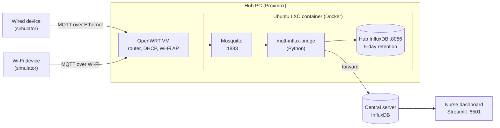
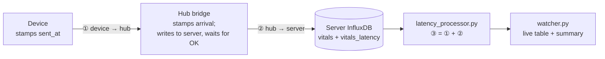

# Patient Monitoring Hub — Overview

## What it is

The Patient Monitoring Hub (PM Hub) is an edge reference implementation that
collects patient vital signs from bedside devices in a hospital ward, keeps a
local copy on a small "hub" PC, and forwards the data to a central server where
the nurse station can see it.

It is a **data-collection and relay** sample: it has no AI, no alarms and no
screen on the hub itself. Jira
[ITEP-97802](https://jira.devtools.intel.com/browse/ITEP-97802) asks to move it
from the OEP reference-scripts repository into HLS AI Suite.

How it differs from the Multi-Modal Patient Monitoring app: Multi-Modal is a
smart bedside monitor that runs AI (rPPG, 3D pose, ECG) for one patient; the PM
Hub is the ward's data network that gathers vitals from many patients and sends
them on. The two are not connected today.

## What it does

1. **Connect:** bedside devices join the ward network by cable or Wi-Fi; the hub
   gives them addresses.
2. **Send:** each device publishes one message per second with five vitals:
   heart rate, SpO2, respiratory rate, body temperature and blood pressure.
3. **Receive and check:** the hub receives the message and checks that all five
   vitals are present; incomplete messages are dropped.
4. **Store locally:** the hub keeps the data for 5 days, so the ward still has
   it if the link to the central server is down.
5. **Forward:** the hub sends the same data to the central server, which keeps
   all wards' history.
6. **View:** the nurse dashboard reads from the central server and shows one
   patient at a time.

## What is used

| Part | Software | Runs on (validated) |
|---|---|---|
| Bedside device | Python simulator `multi_channels_test.py` (paho-mqtt); one "channel" = one patient | ASRock iEP-7020E (wired), Intel NUC11 (Wi-Fi) |
| Hub virtualization | Proxmox VE 9.1 | ASUS IoT PE2300U, Intel Core Ultra 7 265U, 32 GB |
| Hub network | OpenWRT VM: router, DHCP, Wi-Fi access point (MT7612U USB adapter), NAT | same hub PC |
| Hub services | Ubuntu LXC container with Docker: Mosquitto (MQTT broker, port 1883), InfluxDB 2.7 (port 8086, 5-day retention), Python bridge `mqtt-influx-bridge` | same hub PC |
| Central server | InfluxDB 2.7 in Docker | Intel NUC11 |
| Nurse station | Streamlit dashboard (port 8501) | Intel NUC13 |
| Benchmark | `latency_processor.py`, `watcher.py` | central server |

**Intel optimization:** none in the software. It uses only general open-source
components (Mosquitto, InfluxDB, Python), with no OpenVINO, AI or Intel-specific
tuning. The Intel angle is the platform: Intel Core Ultra hardware and Intel
virtualization (VT-x / VT-d) to run the router and the hub on one PC. Not used:
TCC/TSN real-time features, CPU pinning, power or performance tuning.

## How it works



- **Topics:** each device publishes to `<ward>/<patient>` (for example
  `ward1/patient3`). The bridge subscribes to all topics (`#`) and takes the ward
  and patient from the topic name.
- **Message:** JSON with the five vitals plus `msg_id` and `sent_at` (send time).
- **Bridge** (`scripts/monitoring_hub/bridge/app.py`):
  1. parses the message and builds an InfluxDB point; if any vital is missing,
     the message is dropped;
  2. queues one write to the hub InfluxDB and one to the central server;
  3. records timing data for the benchmark (see below).
  Writes go through a queue served by background threads, so a slow database
  does not block MQTT.
- **Proxmox's role:** it only hosts and wires the two parts (the OpenWRT VM and
  the Ubuntu container) and passes the network cards and the USB Wi-Fi adapter to
  OpenWRT. It does not touch patient data.

## Benchmark

### How it works



1. **Send:** the simulator sends each patient's vitals once per second with the
   send time and a message ID.
2. **Arrive at hub:** the bridge notes the arrival time; arrival minus send time
   = device → hub delay.
3. **Forward:** the bridge writes to the server database and waits for the OK;
   that wait = hub → server delay.
4. **Store:** both delays are saved in the server database (`vitals_latency`).
5. **Report:** `latency_processor.py` adds them per message (device → server);
   `watcher.py` shows average, p50, p95 and p99.

Device and hub clocks must be in sync (chrony), otherwise device → hub is wrong.
Only delay is measured — not CPU, memory or power.

### Published results (README)

Device → server delay in seconds; 1, 10, 20 and 30 simulated patients, 120 s per
run, default MQTT settings.

| Patients | Wired avg | Wired p50 | Wired p95 | Wired p99 | Wi-Fi avg | Wi-Fi p50 | Wi-Fi p95 | Wi-Fi p99 |
|---|---|---|---|---|---|---|---|---|
| 1 | 0.181 | 0.161 | 0.354 | 0.467 | 0.109 | 0.088 | 0.184 | 0.382 |
| 10 | 0.128 | 0.123 | 0.193 | 0.220 | 0.113 | 0.079 | 0.301 | 0.369 |
| 20 | 0.215 | 0.205 | 0.390 | 0.479 | 0.211 | 0.107 | 0.749 | 1.186 |
| 30 | 0.209 | 0.205 | 0.334 | 0.397 | **0.836** | **0.758** | **1.929** | **2.167** |

- Wired stays around 0.2 s even at 30 patients.
- Wi-Fi is fine up to 20 patients but slows at 30 (0.84 s average, 2.2 s worst
  case).
- At 1 patient wired is slower than Wi-Fi, which suggests run-to-run noise.

### Our single-machine test

All parts on one PC (no Proxmox, OpenWRT or real network), 5 simulated patients
for 60 s: all 305 messages reached both the hub and the server; device → hub
about 3 ms and hub → server about 14 ms on average. The software itself is fast;
the published delays come from the real network (Wi-Fi, routing, hops between
machines).

## Implementation and benchmark summary

The PM Hub is a plain data-collection pipeline: devices send vitals over MQTT,
the hub saves them and forwards them to a central server. It is **not
Intel-optimized**: there is no AI and no Intel software in it; it only runs on
Intel hardware. The benchmark measures **delay (latency) only**.

### How they implemented the use case

**Use case:** collect vital signs from many bedside devices in a ward, keep a
local copy at the edge, and forward them to a central server for the nurse
station.

| Step | How it's built |
|---|---|
| Bedside device | Python simulator (`multi_channels_test.py`). Each "channel" is one patient sending random vitals with a timestamp, by default once per second, on topic `wardX/patientY`. |
| Network | OpenWRT VM gives devices addresses and Wi-Fi; Proxmox passes the network card and the USB Wi-Fi adapter to it. |
| Hub | Mosquitto (MQTT broker), InfluxDB, and a Python bridge (`app.py`) that writes each message to the hub database and to the server database. |
| Central server | InfluxDB in Docker. |
| Nurse station | Streamlit dashboard that reads from the server. |

### Is it Intel-optimized? No

- **Ordinary software, no Intel tuning:**
  - All of it is generic open-source (Mosquitto, InfluxDB, Python), with no
    OpenVINO, AI or oneAPI.
  - The scripts contain no Intel-specific tuning; a search found nothing.
- **The only Intel angle is the platform:**
  - It runs on Intel Core Ultra and Core hardware.
  - It uses Intel virtualization (VT-x, and VT-d to pass hardware to the VM) to
    run the router and the hub on one PC — the "consolidation" story.
- **Not used:** real-time features such as TCC or TSN, CPU core pinning, power
  or performance tuning.
- **Not measured:** CPU, memory or power use of the hub.

### Benchmark: how it works

- **Who stamps the time:**
  - The device stamps `sent_at` when it sends.
  - The bridge measures **device → broker** (arrival minus `sent_at`).
  - The bridge also measures **broker → server**: how long until the write to
    the server database completes.
- **Where the results go:**
  - Both delays are stored in the server database as the `vitals_latency`
    measurement.
  - `latency_processor.py` calculates average, median (p50), p95 and p99.
  - `watcher.py` shows them live in the terminal.
- **Clocks:** device and hub clocks must be in sync (chrony), otherwise the
  device → broker number is wrong.

### Published numbers (README, device → server, 120 s per run)

| Patients | Wired: average / p99 | Wi-Fi: average / p99 |
|---|---|---|
| 1 | 0.181 s / 0.467 s | 0.109 s / 0.382 s |
| 10 | 0.128 s / 0.220 s | 0.113 s / 0.369 s |
| 20 | 0.215 s / 0.479 s | 0.211 s / 1.186 s |
| 30 | 0.209 s / 0.397 s | **0.836 s / 2.167 s** |

- **Wired** stays around 0.2 s even with 30 patients.
- **Wi-Fi** degrades at 30 patients, with a worst case of about 2.2 s.
- **Odd result:** with 1 patient, wired is slower than Wi-Fi, which suggests
  run-to-run noise.

### Our run on this machine

5 patients for 60 s, all on one PC, so with no real network:

| Run | Device → broker (avg) | Broker → server (avg) | Messages |
|---|---|---|---|
| First run | ~3 ms | ~14 ms | 305 / 305 |
| Run from `local/` | ~3.3 ms | ~15.6 ms | 305 / 305 |

This shows the software itself is fast. The published 0.1–0.8 s comes from the
real network: Wi-Fi, routing, and the hop between machines.

## What we pulled from upstream

**Source:** `open-edge-platform/edge-developer-kit-reference-scripts`, branch
`main`, commit `7bdfd48`, folder
[`samples/patient-monitoring-hub`](https://github.com/open-edge-platform/edge-developer-kit-reference-scripts/tree/main/samples/patient-monitoring-hub).

The sample is self-contained, so the whole folder was copied as is (34 files,
tracked files only, no git history):

```bash
git archive origin/main samples/patient-monitoring-hub | tar -x --strip-components=2 -C patient-monitoring-hub-poc
```

| Path | What it contains | Runs on |
|---|---|---|
| `README.md` | Architecture, validated hardware, benchmark results, get started | — |
| `assets/` | Architecture diagram, demo GIF | — |
| `docs/proxmox_setup.md`, `scripts/proxmox_setup.sh` | Proxmox host setup | Hub PC |
| `docs/openwrt_setup.md`, `scripts/openwrt_setup.sh` | OpenWRT VM setup | Hub PC |
| `docs/monitoring_hub_setup.md`, `scripts/monitoring_hub/` | LXC container setup, `docker-compose.yml` (Mosquitto, InfluxDB, bridge), `mosquitto.conf`, `influxdb_token.env`, `bridge/` (app, Dockerfile, requirements), `setup.sh`, `start.sh` | Hub container |
| `docs/server_setup.md`, `scripts/server/` | `docker-compose.yml` (InfluxDB), `setup.sh` | Central server |
| `docs/benchmark.md`, `scripts/server/benchmark/` | `latency_processor.py`, `watcher.py` | Central server |
| `docs/patient_device.md`, `scripts/patient_device/` | `mqtt_setup.sh`, `multi_channels_test.py` (simulator) | Device |
| `docs/nurse_dashboard.md`, `scripts/nurse_dashboard/` | `nurse_dashboard.py` (Streamlit), `setup.sh` | Nurse station |
| `docs/end_to_end_workflow.md` | Order to start everything and run a test | — |

Local addition: this file (`docs/patient-monitoring-hub-overview.md`).

## How to run

**Reference setup (README):** five machines, in this order — Proxmox host,
OpenWRT VM, central server, monitoring hub, patient device, nurse dashboard,
then the end-to-end workflow. See the guides in `docs/`.

**Single machine (for demos and development):** the hub stack and the central
server can run as containers on one PC without Proxmox or OpenWRT:
- run the hub's Mosquitto, InfluxDB and bridge, plus a second InfluxDB as the
  central server, in one Docker Compose project;
- give the server InfluxDB a different host port (for example 8087) and a
  different container name, because the hub and server both use `influxdb` on
  8086;
- point the bridge's `SERVER_INFLUXDB_URL` at the server InfluxDB and set
  `HUB_TOKEN` / `SERVER_TOKEN`;
- run the simulator with `--broker localhost` and the dashboard against the
  server InfluxDB.

This setup is in `local/docker-compose.yml` (MQTT on 1884, hub InfluxDB on 8086,
server InfluxDB on 8087):

```bash
cd local
# .env with INFLUX_PASSWORD, HUB_TOKEN and SERVER_TOKEN (random values; not committed)
docker compose up -d --build

python3 -m venv .venv && . .venv/bin/activate
pip install paho-mqtt==2.1.0 influxdb-client==1.50.0 streamlit pandas pytz streamlit-autorefresh

# dashboard: local copy pointed at the server InfluxDB
sed -e "s|http://<SERVER_IP>:8086|http://localhost:8087|" \
    -e "s|\"<TOKEN>\"|__import__('os').environ['SERVER_TOKEN']|" \
    ../scripts/nurse_dashboard/nurse_dashboard.py > nurse_dashboard_local.py
set -a && . ./.env && set +a
streamlit run nurse_dashboard_local.py --server.port 8501 &

# simulator: 5 patients for 60 s
python ../scripts/patient_device/multi_channels_test.py --broker localhost --port 1884 --channels 5 --duration 60
```

Stop with `docker compose down` (add `-v` to delete the stored data).

## Points to note

- **Limitations (README):** demo and evaluation only; plaintext MQTT with no TLS
  or device authentication; no disconnect alerts; duplicate or out-of-order
  messages are possible.
- **Setup effort:** needs a wiped PC for Proxmox, five machines, specific
  hardware (MT7612U USB Wi-Fi adapter, two Ethernet ports) and many manual
  steps — unlike other suite apps (Docker + make on one machine).
- **Hard-coded values:** subnets, VM/container IDs (201, 102), the
  `/root/monitoring_hub` path in `start.sh`, and placeholder server URL / tokens
  in the dashboard and benchmark scripts.
- **No proxy support:** downloads may fail on Intel's network.
- **Bridge health check bug:** the bridge container always shows "unhealthy"
  because its health check uses `pgrep`, which is missing in the
  `python:3.11-slim` image; the bridge itself works.
- **Not for clinical use:** reference implementation only.
